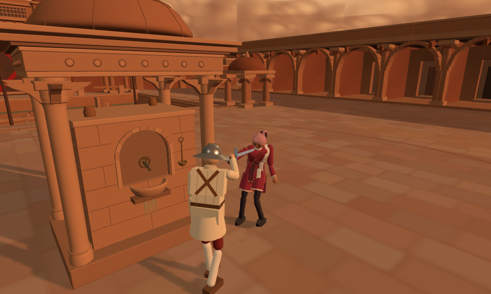
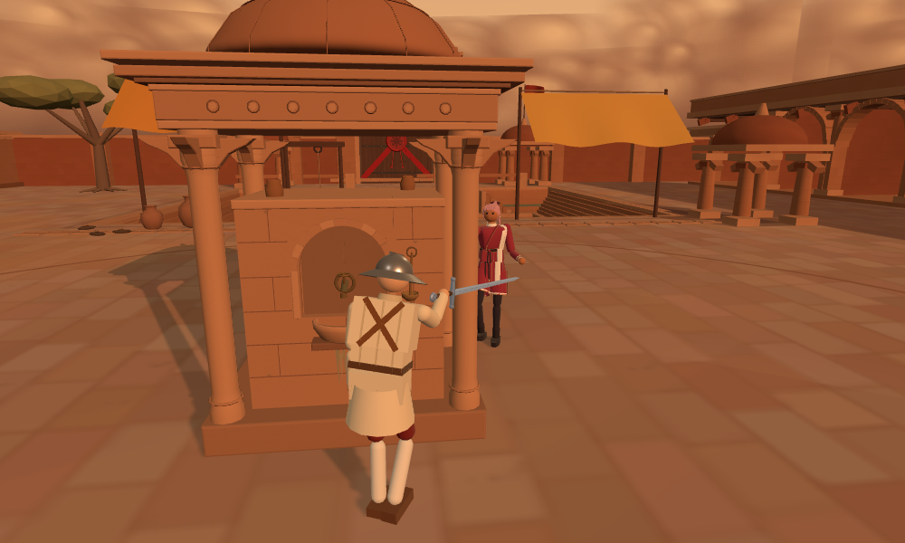

# 중정 엄폐 연구 결과 — 2026-10-19

**다음 사람 시험에는 ‘실제 사선으로 마야의 우회를 판단하는 안’ 하나를 권한다. 시작점 변경은 보류한다.** 엄폐 둘레를 움직이는 대본에서 이 안은 실제 생존과 총탄 차폐를 개선했다. 다만 엄폐에서 나와 근접 공격으로 잇는 이득은 확인하지 못했다. 정식 채택·게임 적용 판단은 아직 아니다.

사용자 ‘연구 수행해’ 승인에 따른 [앞선 제안](../courtyard_cover_review_20261019/README.md)의 실행이다. 우화 최신을 다시 확인해 **`44b17d86f4b8d595bc452b8a27c8901089c940ab`**에 고정했다. 앞선98a83cf5 이후 바뀐 combat/config/main/nagashi_recovery도 새 기준으로 사용했으며 중정/AI/총기/카메라 코드는 그 사이 같았다. 게임 원본과 우리 작업 src는 수정하지 않았다. 별도 `/tmp` 소스에서만 후보를 실행했다. 배포·원격 쓰기·우화 메시지는 없다.

## 1. 무엇을 비교했나

| 군 | 내용 |
|---|---|
| 기존 `base` | 현재 우화 게임 동작. 두 시작점 z=1.85. 사선·이동 판단 모두 반경1.95m 원을 사용. |
| 실제 사선 `exact` | 총구에서 골반/배/가슴중앙·좌우/머리 **6점이 모두 급수정에 가릴 때** 사선 확보용 우회. 하나라도 열리면 원만 보고 강제 우회하지 않음. 몸이 가까운 돌로 향할 때의 이동 충돌 회피는 별도로 유지. 시작점은 현재 그대로. |
| 결합 `combined` | exact + 시작점 플레이어(-2.8,1.10), 마야(2.8,1.60). |

총탄의 실제 충돌·발사 판단·쿨타임·명중 보정·위력·마야 속도/힘은 바꾸지 않았다. exact는 ‘고도별 사선 판단’과 ‘전 표적 선분 대신 가까운 이동경로로 충돌 회피 구분’을 함께 바꾼 **좁은 우회 후보**다. 효과를 사선 한 줄만의 독립 효과라고 해석하지 않는다. 이동경로는 현재 입력 방향0.75m 앞과 기존 여유 원을 검사한다. 물리 총알은 기존 실제 총구 광선을 그대로 사용한다.

후보는 연구 플래그 `COVER_STUDY.on`으로 분리했다. [candidate.patch](candidate.patch)는 `arena_obstacle.js`와 작은 연구 helper만 변경하며 다른 원본 의존76파일은 SHA256 동일하다. 원본 의존79파일(화면용2개 포함)은 [upstream-dependencies.tar.gz](upstream-dependencies.tar.gz), [출처/파일별 해시](sources.json)에 있다.

## 2. 대본의 실패를 먼저 수정했다

처음 제안한 시작쌍(.65/1.15)은 실제 총구로 검사하자 **처음부터6점 전부 가렸다**. ‘마야를 보고 한 옆걸음으로 숨기’ 목적과 달라12초 pilot 결과를 보존하고, 시작쌍6개를 검사해 처음6점 모두 열리는1.10/1.60으로 고쳤다. 더 낮은 .90/1.40도6점 중5개가 가려져 쓰지 않았다.

1차는 4상황×3seed×3군=**36전**, 각 최대30초였다. 그러나 ‘장전 소리에 접근’은 장전 전 패배가 많아 숨기와 동작이 중복됐다. 또 총기 전용 난수가 검객index에 고정되어101/203의 같은 반응지연 조건이 중복됐고, 시작점을 고정한 두 가장자리 조건에서 exact/combined가 같은 것은 설계상 당연했다. 이36전을 독립 표본36개로 주장하지 않는다. 전부 [원자료](raw-results.tar.gz)에 보존했다.

그래서 무작위seed 숫자를 늘리는 대신 **두 다른 입력 대본×두 명시적 반응지연(.20/.35초)×3군=12전**만 후속으로 실행했다.

- **엄폐 둘레 이동:** 원형으로 상대 반대편을 향해 걸으며, 카메라에서 상대 머리/가슴 중 하나가 급수정에 가리지 않을 때만 위치 정보를 갱신한다. 가렸을 때는 마지막 관측 위치를 쓴다. 입력은 .20/.35초마다 갱신한다. 거리2m 안에서는1초마다 기존 찌르기 입력을 시도한다.
- **첫 총성 뒤 접근:** 기존 엄폐 진입을 하다가 첫 총성을 듣고 정해둔 북쪽 두 경유점을 지나 마야에게 접근, 같은 찌르기 입력을 시도한다. 장전까지 기다리다 동작이 사라지는 문제를 없앴다.

이는 **사람의 행동을 가정한 프로그램 입력**이다. 손가락 오차·인지·계획·카메라 혼란을 재현한 인간 실험이 아니다. 엄폐 둘레 대본도 공간 좌표로 목표를 계산하므로 사람보다 경로 선택이 정교할 수 있다. 마야는 실제 AI이며 양쪽 물리·상처·기력은 실제 게임 계산이다. 현재 시뮬 기본의 시작2초 발 묶임을 포함한30초이고, 먼저 어느 한쪽이 패배하면 끝낸다.

## 3. 후속12전 결과

### 엄폐 둘레 이동 — 방어 이득 확인, 공격 이득 미확인

| 두 입력지연의 결과 | 기존 | 실제 사선 | 사선+시작점 |
|---|---:|---:|---:|
| 30초 내 플레이어 패배 | 2/2 | **0/2** | 1/2 |
| 각 종료시각(초) | 16.04 / 9.81 | **30 / 30** | 30 / 20.41 |
| 누적 완전차폐 평균(초) | 0 | **19.77** | 15.47 |
| 팔다리 기능 손실 합계 | 1.447 | 1.447 | 0.723 |
| 새로 더해진 출혈률 합계 | .5093 | **.0397** | .0985 |
| 종료 때 혈액 손실 평균 | 31.9% | **15.8%** | 27.5% |
| 이동 기력 소모 평균 | 16.1 | 35.0 | 25.9 |
| 총 이동거리 평균(m) | 8.44 | 15.70 | 12.01 |
| 거리2m 이내 시간 평균(초) | 6.78 | **0** | **0** |
| 받아들여진 찌르기 입력 합계 | 13 | **0** | **0** |

여기서 ‘완전차폐’는 **상체6개 표본 모두가 급수정에 가렸다는 지표**다. 팔·다리의 모든 표면까지 총탄에서 안전하다는 보장은 아니다.

exact의 약20초는 **누적**이다. 한 번 연속 가린 최장 시간은2.45~2.78초다. 마야가 사선을 되찾았다가 플레이어가 다시 끊는 과정이 반복됐다. 마야는9~10발을 쐈고 각각 몸1발/돌8~9발이었다. 발사 LOS 자체는 바꾸지 않아 돌에 탄을 소모하는 현재 규칙이 유지됐다.

인간에게 기대할 이득은 ‘숨을 곳이 실제로 사는 선택지가 된다’는 점이다. 반면 이 대본에서는 마야에게 접근해 공격할 기회가 없어졌다. 이동·기력 총량도 늘었지만 오래 살아 움직인 영향이 섞이므로 위 총량만으로 입력 부담이 배가됐다고 말하지 않는다. 관측된 최소 기력과 자세·경로는 각 raw JSON에 있다.

### 첫 총성 뒤 접근 — 추천 효과 확인 못 함

| 두 입력지연의 결과 | 기존 | 실제 사선 | 사선+시작점 |
|---|---:|---:|---:|
| 30초 내 플레이어 패배 | 2/2 | **2/2** | 2/2 |
| 각 종료시각(초) | 13.25 / 13.72 | **12.78 / 12.76** | 15.37 / 15.40 |
| 거리2m 이내 시간 평균(초) | 3.57 | **0** | 1.79 |
| 받아들여진 찌르기 입력 합계 | 8 | **0** | 4 |
| 마야 혈액 손실 평균 | 1.1% | **0%** | 3.0% |

exact의 원 불일치 제거는 마야가 불필요하게 플레이어 쪽으로 돌아 들어오던 기회를 없애기도 한다. 이 접근 대본에서는 사거리 안으로 못 들어가 더 빨리 패배했다. 공통 관찰시각(~12.7초)에도 exact의 출혈 증가량은 두 조건 모두.1868로 기존.1427보다 컸다. 따라서 전체 싸움을 쉽게 만든 개선이라고 결론내리지 않는다.

종료시각이 다른 판의 최종 혈액만 비교하는 오류를 피하려고 [summary.json](checks/summary.json)에 각 짝의 가장 이른 종료시각 직전 공통시간 집계도 넣었다(저장 간격0.1초 이하 오차). 사지·의식·추가 출혈률을 구별했고 에너지 합을 HP로 바꾸지 않았다. 패배와 생존은 표에서 별도 유지했다. 전체48전은 [cases.csv](cases.csv), 초기36전/후속12전은 별도 구분했다. 새 시작점은 빠른 입력의 무상처 이득도 있으나 느린 엄폐 입력에서 exact보다 나빠 **추가 채택 근거 부족**이다.

## 4. 카메라 별도 진단

현재 카메라의 정해진12동선(중정6+습지6)을 재실행했다. 중정 벽 옆102.5°/100.6°, 옆 통과83°의 한 프레임 급전환을 재현했다. AI 우회 연구의 카메라는 그대로 두었다.

독립 후보 [camera_candidate.patch](camera_candidate.patch)는 **고른 어깨 쪽에 여전히 유효 경로가 있으면, 반대쪽이 더 짧아도 즉시 갈아타지 않는다**는 한 조건만 변경한다.

| 중정 동선 | 기존 한 프레임 최대 | 후보 | 새로 내 몸 표본이 가린 프레임 |
|---|---:|---:|---:|
| 긴 면 벽 옆 | 102.5° | 2.6° | 0 |
| 짧은 면 벽 옆 | 100.6° | 2.3° | 0 |
| 돌 옆 통과 | 83.0° | 3.8° | **3** |

카메라가 돌 안에 든 프레임은 두 안 모두0이었다. 후보의 옆 통과3프레임(60fps의50ms)은 머리/가슴/골반3표본 중 하나 이상이 가려진 시간이다. 실제 사람 전체가 완전히 사라진 시간이라고 하지 않는다. 공유 습지에는14~17프레임 가림이 생겼다. **공통 즉시 적용은 보류**, 중정에 한정해 가림을 함께 보완할 후속 후보로 남긴다. 더 큰 각도로 돌아갈 수 있다는 비용도 있다. 이 카메라 후보는 위48전 승패 비교에 섞지 않았다.

## 5. 실제 강체 자세 재생 화면과 검증

아래는 최신 우화 무대/인물 소스와 **같은5.008초의 실제 물리 강체 위치·회전**을 사용한 로컬 Chromium 연구 렌더다. 게임의 무대 생성·인물 모델·카메라 좌표·조명 함수를 사용했다. 생성 이미지나 설계 예상도가 아니다. 다만 **본판 전체 UI/터치 게임을 실행한 스크린샷은 아니며**, HUD·총구 효과·상처 표시까지 재생한 것도 아니다. 색/밝기 후처리는 없다.

| 기존: 급수정 옆에서 마야에게 노출 | 실제 사선: 몸체를 끼운 차폐 |
|---|---|
|  |  |

카메라에서 마야가 보인다는 것과 **총구→플레이어가 돌에 막힌다는 것**은 다르다. 오른쪽에서 마야 일부가 보여도 검사6점은 막혀 있다. 두 그림의 차이는 같은 초기조건과 입력 정책에서 AI 경로가 달라진 결과이며, 인물이나 돌을 사진용으로 임의 이동하지 않았다.

- 기존/후보 양쪽 `courtyard_cover.mjs` 통과: 중앙3발 world/상처0, 열린 양옆2발 body/상처1. 마야3경로 우회·몸 캡슐 충돌·장애물 교체 정리도 통과.
- [기능14조건](checks/route-probe.json) 통과: z1.85 실제 열린 선에서 기존은정지입력→.65 강제우회, 후보는0 유지. 중앙은 양쪽.65 우회 유지.
- 시작점을 고정한 가장자리6짝에서 exact와 combined 전체 결과가 동일. 시작점 외 별도 숨은 변경 없음 확인.
- 화면을 위한10초 재생2회가 원래30초 결과의 매0.1초 프레임과 정확히 같음. 캡처 계측으로 결과가 바뀌지 않음 확인.
- 브라우저 렌더2장 페이지 오류0. 이미지 직접 확인. 실제 휴대폰·터치 조작·FPS·사람 손맛은 미검증.
- 실행 종료코드: 36전+12전 전부0. Rapier 초기화 인자 deprecation 경고는 stderr에 보존. 더 큰 무관한 회귀 스위트는 돌리지 않았다.

## 6. 권고와 재현

**우선 후보는 실제 사선 우회 단독이다.** 현재 시작점과 총기 수치는 유지한 사람 비교에서 ‘엄폐 진입→사선 끊기→발 사이 이동/장전 접근’을 확인할 가치가 있다. 이번은 살기 위한 엄폐의 효용을 확인했고, 이기기 위한 반격까지 완성하지 못했다. 총수가 우회를 못 하게 멈추거나 일부러 느리게 만드는 안은 시험하지 않았다. 건물 확대 역시 아직 근거가 없다.

비대칭 시작점은 보류한다. 카메라는 어깨 방향 유지의 각도 개선을 보존하되, 중정 전용으로 짧은 자기 가림까지 해결한 뒤 사람 시험에 붙이는 것이 좋다. 추가 코드/배포 없이 이번 연구를 여기서 마친다.

원자료는 `raw-results.tar.gz`에 탐색36전·후속12전·초기pilot·탈락 시작점·카메라/검사 stdout/stderr·화면 강체 데이터를 포함한다. 패치의 불리한 결과와 중복 대본을 삭제하지 않았다. SHA256은 `SHA256SUMS`, 소스 개별 해시는 `sources.json`이다.

재현 시 기존 체크아웃을 바꾸지 말고 `/tmp` 디렉터리에 `upstream-dependencies.tar.gz`를 풀어 `{"type":"module"}` package.json과 기존 프로젝트 node_modules 링크를 둔다. 그곳에서 `patch -p1 < candidate.patch` 후 `tools/tools/sim/cover_study.mjs`를 실행 디렉터리의 `tools/sim/cover_study.mjs`로 복사한다. 예:

```sh
node tools/sim/cover_study.mjs exact cover_loop 110 /tmp/courtyard-replay.json 30
```

`110`은 입력0.20초, `111`은0.35초다. `base/exact/combined`, `cover_loop/push_first`의12조합이 최종 후속이다. 초기36전은 원자료 안 `pilot/cover_study_v2.mjs`가 그때 실행본이며 현재 도구에도 동일 초기 시나리오가 남아 있다. 실행 도구의 기본 경로는 이 작업의 `/tmp/courtyard-cover-study-20261019`이므로 다른 경로에서는 출력 경로를 함께 바꾼다. 카메라 후보는 별도 패치이며 승패 비교와 분리해서 실행한다. 제공한 `tools/prepare_camera_candidate.py`를 추출·후보패치 디렉터리에서 실행하면 진단 도구가 읽는 별도 카메라 모듈을 만든다. 제공한 두 visibility 도구를 실행 디렉터리 `tools/sim/`에 복사하고 `node tools/sim/camera_sticky_visibility.mjs /tmp/camera-sticky.json --walk` 및 baseline 도구로 비교한다.
