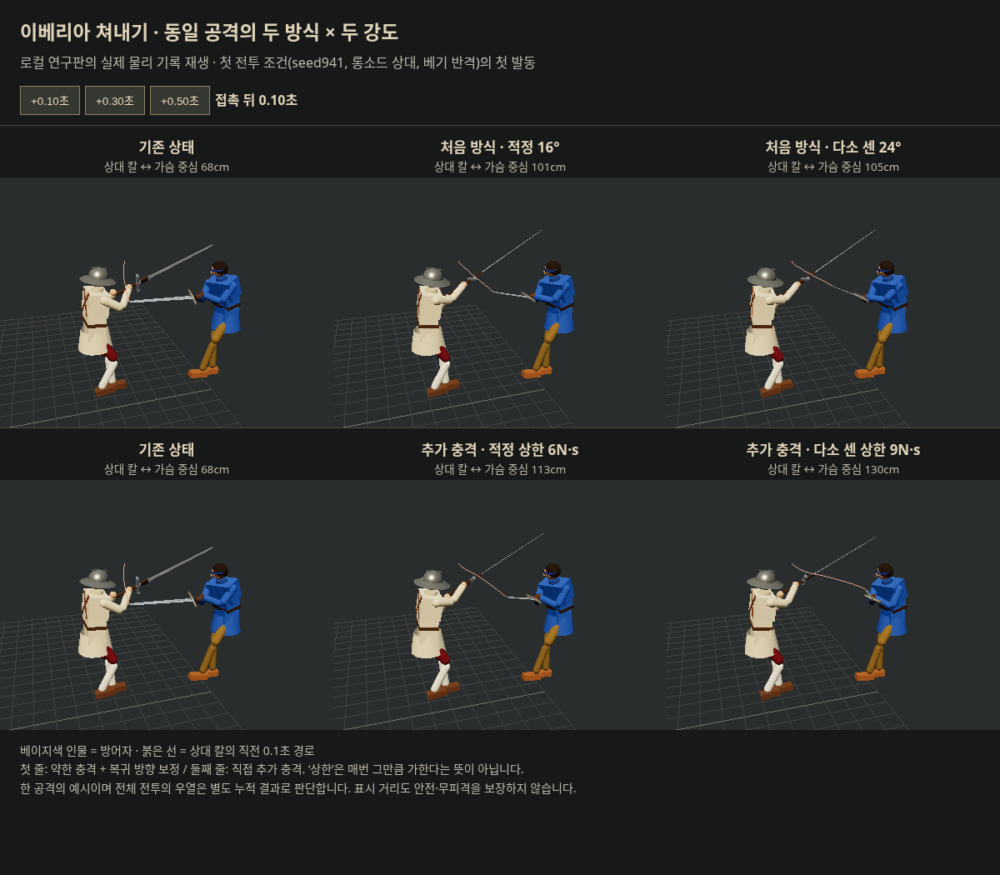
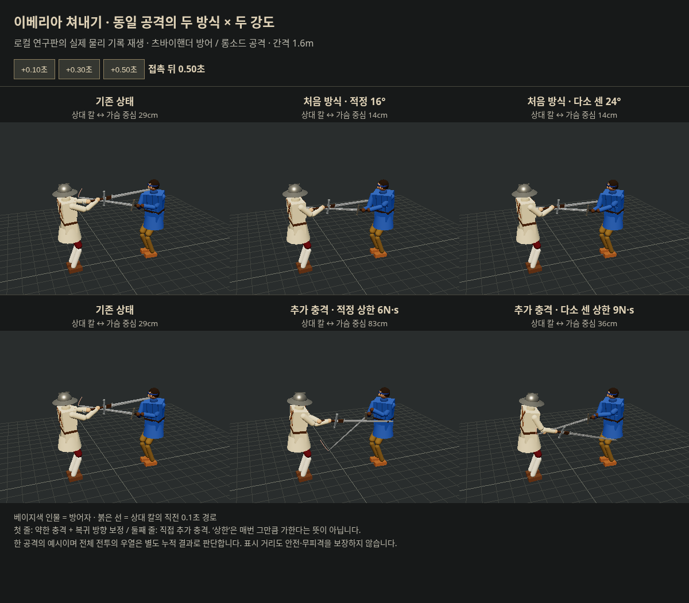

# 이베리아 쳐내기 — 두 방식 × 두 강도 비교

2026-10-18. 사용자 요청: 처음 고안한 방식과 추가 충격 방식을 적정·다소 센 강도로 비교하고 전투 양상의 변화를 보고한다.

**추천은 직접 추가 충격 6N·s 상한을 첫 인간 시험 후보로 유지한다. 다만 ‘안전한 방어 상향’으로 확정할 수 없다.** 짧은 칼 이탈과 반격 연결의 가능성은 있으나 이번 전투에서도 의식 손상이 커졌다. 강도만 높인 9N·s는 순간 튕김이 더 크지만 새 팔 베임·사망 증가를 동반했고, 더 긴 안전 구간으로 이어지지 않았다.

## 기준과 비교군

실험 소스는 기존 연구 `223b5cd8d244518ee82bdeab1dbd5a7de8a27401`, 기준 수신은 로컬 확보 `32b4dabaa0c2d3f2149d793e2b93516ba585db92`. 원격 최신판을 새로 동기화한 연구라는 뜻은 아니다. 기존 연구·기각안은 [이전 전체 기록](../iberian_beat_20261018/README.md)에 보존한다.

|군|접근 속도 배율 / 추가 상대속도 상한|충격 상한|상대 칼 목표 방향 보정|
|---|---|---|---|
|기존|0|0|없음|
|처음 방식 · 적정|0.7 / 4m/s|3N·s|16°, 0.28초 안에 소멸|
|처음 방식 · 다소 센|0.7 / 4m/s|3N·s|24°, 같은 0.28초|
|추가 충격 · 적정|1.4 / 8m/s|6N·s|없음|
|추가 충격 · 다소 센|2.1 / 12m/s|9N·s|없음|

- ‘적정’은 직전 연구의 시험 후보라는 뜻이며 최적값으로 검증된 호칭이 아니다. 강한 군은 각 방식의 핵심 강도를 50% 높였다. 처음 방식은 **약한 실제 충격 + 칼의 복귀 목표를 짧게 바깥으로 기울이는 보정**이다. 이전에 기각한 팔 힘 저하는 두 방식 모두 쓰지 않는다.
- 실제 충격은 접근 속도·합성 유효질량에 따라 상한 아래일 수 있다. 실제 highL/highR 막기 접촉, 같은 공격 1회/최소 0.6초, 두 칼의 반대 충격은 공통이다. 자세·보법 정의와 기력 규칙을 바꾸지 않았다.
- 앞선 9N·s 비교는 배율2.0이었다. 이번은 배율2.1이며 동일 후보/동일 표본인 것처럼 결과를 합치지 않는다.

## 실험 규모와 읽는 법

본 비교 **180실행**: 최대30초 전투 **12조건 × 5군 = 60**, 단발/반격 진단 **24조건 × 5군 = 120**. 재생 사진을 위한 동일 조건 재실행·계측 중립 검사 등은 본 비교 수에 더하지 않는다.

- 전투: 새 seed941/942 × 상대 롱소드·청강검·츠바이핸더 × 베기/찌르기 반격 입력. 플레이어 츠바이핸더. 접촉에 대한 반격 입력 지연은 seed별 0.18/0.28초 + 0~0.10초. 방어 판단은 보이는 거리·칼 속도로 한다. AI 내부 공격 상태로 인간 입력을 결정하지 않는다.
- 같은 초기값·입력 정책을 짝지었다. 물리 결과가 달라진 뒤 정책이 내는 실제 버튼·이동 시각은 달라질 수 있다. 동일 입력을 끝까지 강제한 것은 단발 진단이며, 실제 인간 플레이를 했다는 뜻이 아니다.
- 단발: 6공격 × 거리1.4/1.6m × 반격 없음/접촉0.25초 뒤 베기. 상대 롱소드. 기존 진단을 네 후보에 맞춰 다시 비교했으며 독립 전투 표본으로 합산하지 않는다.
- 전투 피해는 **각 조건의 다섯 군 중 가장 일찍 종료한 시각까지**를 함께 잘라 공통 노출 시간으로도 비교했다. 합계311.19초/군. 최종 사망은 각 판 전체 결과다. 빨리 죽어 누적 피해가 적어진 후보를 좋은 결과로 세지 않는다.
- 임의의 HP 점수로 합치지 않았다. 실제 적용된 팔다리 기능 감소·의식 감소·출혈률 증가를 따로 계산한다. 의식 손상은 회복 후 다시 손상되는 양도 누적한 값이다.
- ‘반격 뒤 유효타’는 입력 뒤1초 안에 실제 상처·통증·균형 등 변화가 있었던 입력 수다. 적중의 유일한 원인이 반격이었다는 인과 증명, 치명타율, 막기 성공률이 아니다. 겹치는 입력 구간은 다음 입력에서 잘라 중복 집계하지 않는다.

## 1. 실제로 얼마나 튕기는가

전투에서 처음 발동한 **8조건**은 발동 전 상태·시각이 다섯 군에서 동일했다. 나머지4조건은 모든 군에서 발동하지 않았다. 같은 첫 발동을 짝지어 상대 칼 선분과 방어자 가슴 중심 사이의 거리 변화를 측정했다. 양수=기존보다 멀어짐, 음수=기존보다 가까워짐. 몸 전체 피격 안전거리와는 다르다.

|후보|접촉0.1초 뒤 추가 거리 중앙값|0.3초 뒤|0.5초 뒤|
|---|---:|---:|---:|
|처음16°|+3.7cm|+2.6cm|−1.3cm|
|처음24°|+6.0cm|+3.4cm|−1.5cm|
|직접6|+11.5cm|+1.1cm|+0.7cm|
|직접9|+24.1cm|+0.9cm|−3.2cm|

**직접 충격은 접촉 직후의 칼 이탈이 더 크다. 그러나 0.3초 이후의 이점은 작고 방향도 일정하지 않다.** 더 센 쳐내기가 더 긴 안전한 반격 시간을 자동으로 사주는 구조는 아니다. 예를 들어 직접6의0.1초 변화도 −0.8~+44.8cm로 상황차가 크다. 평균적 사람이 이 차이를 확실히 느낀다고 단정하지 않는다.

첫 전투 조건의 첫 접촉0.1초 후(좋은 결과를 골라 만든 화면이 아니라 행렬의 첫 조건):



## 2. 최대30초 전투의 손익

사망을 제외한 아래 손상 변화는 **공통 노출 시간**의 기존 대비 변화다. 전체 전투의 막기 지출은 생존 시간 차이도 있으므로 별도 표에 명시한다.

|후보|플레이어 사망 / 12조건|내 팔다리 손상|내 의식 손상|내 출혈률 증가 누적|반격 뒤 유효타가 난 입력|
|---|---:|---:|---:|---:|---:|
|기존|2|기준|기준|기준|61/102|
|처음16°|3|−17%|+34%|−37%|63/93|
|처음24°|1|+28%|+1%|−35%|62/103|
|직접6|1|+3%|+68%|−36%|67/102|
|직접9|3|+9%|+40%|−18%|68/98|

- **처음16°:** 공방 속도가 조금 느슨해지고 팔다리·출혈 손실이 줄어드는 방향. 반격 입력은102→93이지만 그 뒤 유효타는61→63이었다. 다만 청강검 상대 베기 반격 두 조건에서 기존에 없던 머리 사망이 생겼다. 안정된 방어라고 부를 수 없다.
- **처음24°:** 초반 벌어짐은 조금 커지지만16°와 다른 수준의 장시간 제압은 아니다. 이번에는 사망1로 줄었으나 팔다리 손상은28% 증가, 반격 뒤 내가 입은 팔다리 손상은39% 증가했다. 더 세게 보정할 근거가 약하다.
- **직접6:** 반격 입력 수가 기준과 같은102인데 뒤따른 유효타가61→67. 반격 뒤 내가 입은 팔다리 손상은21% 감소했다. 반면 서로 의식 손상이 커졌다(내+68%, 상대+52%). ‘칼을 쳐내고 공격을 이어가는’ 시험 후보로 가장 맞지만, 머리 위험을 해소한 방어 버프는 아니다.
- **직접9:** 초기 칼 이동은 가장 크고 반격 뒤 유효타도 많았다. 그런데 반격 뒤 내 팔다리 손상은37% 증가하고 사망은3으로 늘었다. 상대 사망도0→1이지만, 서로 더 위험해지는 결과에 가깝다.6보다 좋은 종합 결과라고 판단하지 않는다.

|전체 전투 지표|기존|처음16°|처음24°|직접6|직접9|
|---|---:|---:|---:|---:|---:|
|실제 전투시간 합(초)|344.77|330.96|351.55|351.55|329.45|
|막기 기력 지출 합|416.0|403.9|440.2|387.7|383.7|
|실제 노출30초당 막기 지출|36.2|36.6|37.6|33.1|34.9|
|기력 음수인 시간 합(초)|10.1|0.6|17.8|10.5|7.8|
|상대 사망|0|0|0|0|1|

**전투 전체가 밀쳐내기·긴 경직 싸움으로 바뀌지는 않았다.** 공통 시간에서 평균 두 사람 간격은1.75~1.78m, 클린치 시간은 모두0이었다. 적 공격 기력 청구 빈도는30초당 기존14.75 /16°13.30 /24°14.75 /6충격13.98 /9충격15.04. 공격 청구는 실제 유효한 공격·공격 체감 속도와 구별해야 한다. 주요 차이는 전투 간격보다 충돌 직후의 재접촉·반격 교환에 있다.

## 3. 같은 공격에서 드러난 역효과

단발 zornhau, 롱소드, 간격1.6m에서 기존·직접6은 추가 상처가 없었다. 처음16°/24°는 반대쪽 팔에 가벼운 둔타가 생겼고, 직접9는 접촉 약0.15초 뒤 **같은 팔에 새 베임(기능 감소0.650)**이 생겼다. 실제 충격은각1.889/1.889/3.777/5.666N·s였으므로, 단순히9상한에 닿을 때만 생기는 문제도 아니다.

0.5초 뒤 상대 칼과 가슴 중심 거리는 기존29cm / 처음16·24°14cm / 직접6 83cm / 직접9 36cm였다. 앞쪽 한 순간의 칼 이동을 뒤쪽 안전으로 오인하면 안 된다. 처음 방식은 움직이는 목표를 계속 보정하는 동안 칼이 되돌아오거나 다시 맞물릴 수 있고, 강한 직접 충격은 관절에 묶인 칼의 회전·반대편 칼의 반작용까지 바꾼다. 이 특정 사례를 모든 공격으로 일반화하지 않는다.



접촉0.25초 후 같은 베기 반격을 넣은12진단의 상대 팔다리 손상 합은 기존0.119 /16°0.004 /24°0.032 /6충격0.507 /9충격0.403.16°가 모든 실전 반격을 방해한다는 결론은 아니다(전투에서는 다른 결과도 있었다). 다만 짧은 목표 보정이 자동으로 반격 공간을 확보해주는 것도 아니라는 원인 진단이다.

## 판단과 남은 한계

1. **이베리아의 ‘물리적으로 쳐내고 공격을 이어감’에는 직접6부터 사람에게 시험할 가치가 있다.** 이번에도 사망 감소 신호·반격 연결·막기 지출 감소가 있지만, 의식 손상 증가는 두 차례 연구에서 반복되었다. 종합 순이득 확정으로 발표하지 않는다.
2. 처음16°는 비교 대상으로 보존할 가치가 있지만,24°로 올리거나 직접9로 키울 근거는 부족하다. 필요한 다음 보완은 무조건 큰 힘/긴 시간보다 **튀긴 칼의 복귀·재접촉 방향 및 내 칼의 반작용**이다. 이번 비교는 그 보완을 이미 구현한 결과가 아니다.
3. 실제 인간 플레이0. 두 seed/두 반격 정책, 무기3종의 작은 비교이며 통계적 유의성·실제 플레이 빈도·최적값을 주장하지 않는다. 단발 조건은 실제 전투 빈도 계산에 쓰지 않았다.
4. AI 쳐내기는24°군에서1회, 나머지0회뿐이다. 인간이 이베리아 AI에게 당하는 쪽의 체감/손익은 충분히 검증되지 않았다. 플레이어 방어 중심 결과를 양 역할에 일반화하지 않는다.
5. 이벤트 전체의 평균 칼 이격은 후보마다 발동 상황이 달라져 선택 편향이 생긴다. 핵심 거리 비교는 **같은 첫 사건8개**만 사용했다. 분석용 몸 주변 반경도 실제 피격 콜라이더/안전시간 판정으로 쓰지 않는다.

## 재현·파일·검증

- `tools/sim/iberian_compare.mjs`: 비교 설정·읽기 전용 관찰. `raw/live-*.json` 5개, `raw/probe-*.json` 5개에 전체 명령·상처·발동·시간 기록.
- `tools/sim/iberian_compare_summary.py`: 짝검사·공통 시간·유효타 구간·첫 사건 계산 → `summary.json`.
- 재생은 게임 `Fighter`와 실제 강체 위치/회전으로 렌더링. 모델 사진을 생성형 이미지로 대체하지 않는다. 중립 실험장 기록이며 실제 인간 플레이/여정 스테이지 촬영은 아니다.
- 계측 중립 검사: 실제 발동을 포함한 직접6의16초 결과에서 관찰을 켜기 전후 전체 결과JSON 완전 일치(`checks/observer.json`). 새 `src` 변경0이므로 이전5관문·구현검사·빌드 결과를 새로 실행했다고 주장하지 않는다. 새 재생 브라우저6패널 오류0.
- 일반 게임 기본 설정 변경과 우화 발송은 이번 비교에 포함되지 않았다. 연구는 우리 포크의 별도 연구 가지에 보존한다.

```sh
node tools/sim/iberian_compare.mjs neutral
node tools/sim/iberian_compare.mjs live
node tools/sim/iberian_compare.mjs probe
python3 tools/sim/iberian_compare_summary.py
node tools/browser/iberian_compare_record.mjs
node tools/browser/iberian_compare_record.mjs --live
# npm run dev -- --host 127.0.0.1 --port 4338 --strictPort
PLAYWRIGHT_MODULE=/workspace/cloud-onboarding-tools/node_modules/playwright/index.mjs node tools/browser/iberian_compare_capture.mjs
PLAYWRIGHT_MODULE=/workspace/cloud-onboarding-tools/node_modules/playwright/index.mjs node tools/browser/iberian_compare_capture.mjs --live
```

Node24.19.0 / Rapier0.19.3 / Three0.186 / dt=1/120초. 사진의 표시 시각은 접촉 기준이다. 계측·재생 도구는 일반 게임에 후보를 자동으로 설치하지 않는다.
