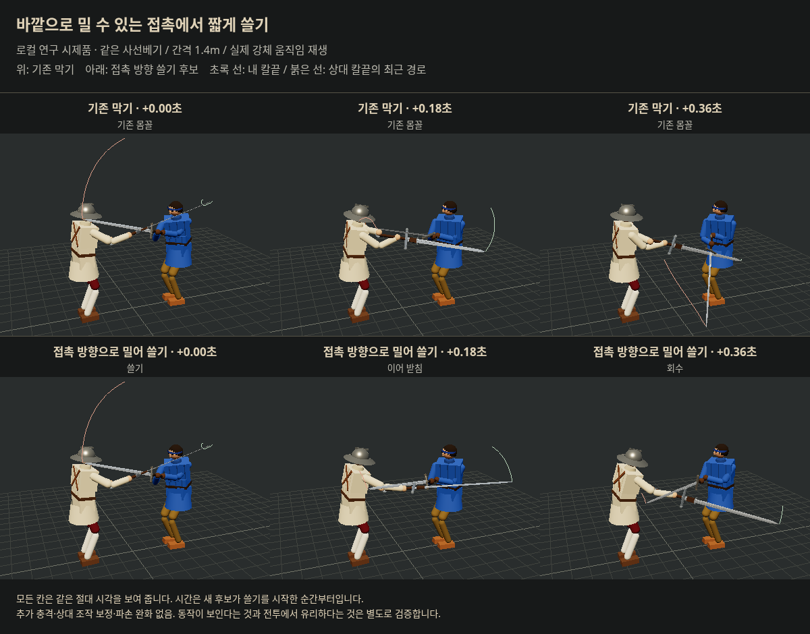
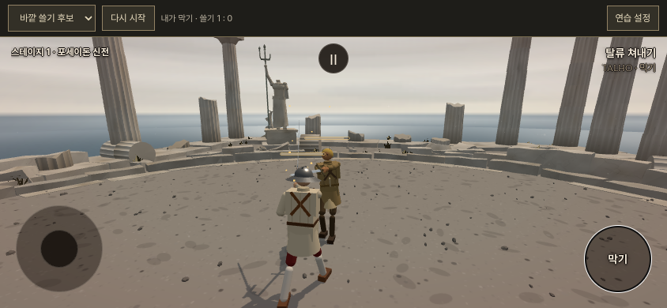
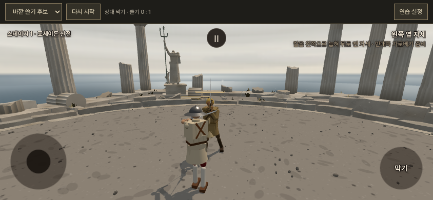

# 이베리아 물리 쓸기 2차 — 2026-10-18

사용자: “쓸만한 방식이 나올 때까지 더 진행해봐.” 앞 시험의 목표 보정과 추가 충격은 손맛 부족, 추가 충격은 파손 증가로 거절됐다. 이번에는 자기 손/검의 경로만 움직였으며 상대 강체의 속도·위치·충격을 직접 고치지 않았다.

**판정: `outward24`를 인간 시험 후보로 남김. 정식 채택/최적값/손맛 완성은 아님.** 두 비교 묶음에서 팔다리 손상·출혈 증가량은 감소, 의식 손상은 증가했다. 발동 빈도가 낮고 즉시 크게 튀는 효과는 확인되지 않았다. 큰 쓸기나 단순 유지안을 성공으로 포장하지 않는다.

기준 소스 `ad496b253bb6c01f9b0d742e14eeb2485a21a59e`, 가지 `codex/iberian-beat-research-20261018`. 이번 연구는 도구와 독립 시험 페이지에만 설치한다. `src`·일반 게임 기본값·유파 해금/보법 변경0, 우화 쓰기/메시지 발송0. 추후 전달 승인 시 수신 최신 main에 맞추는 작업은 별도다.

## 1. 남긴 방식

- 기존 이베리아2급 highL/highR 막기로 **실제 칼 접촉**이 생긴 뒤 판단한다. 무기·방어 책·생존·탈진·막기 입력 조건을 따른다.
- 상대가 내 칼을 미는 접촉 법선의 반대 방향을 읽는다. 이 방향이 접촉점에서 몸 바깥을 향하는 경우에만 쓸기를 시작한다. 불리한 방향에는 자세 유지조차 덧붙이지 않는다.
- `outward = normalize(contact − chest) · (−feel.normal)`. `gain = clamp((outward − .1)/.4)`, gain ≥ .25에서만 시작한다. 즉 outward ≥ .2. 성공 확률 굴림이나 무적 판정이 아니다.
- **0.18초 쓸기 + 0.10초 이어 받침 + 0.20초 회수**, 최대0.48초. smoothstep으로 들어가고 나온다. 손 목표 최대9.6cm, 검 방향 벡터 최대.24를 접촉 방향으로 더하고 정규화한다. 실제 움직임은 원래 팔·손목·몸 모터가 수행한다.
- 같은 방어선이 중간에 풀리며 동작을 잘라 먹지 않게 진행 중인 줄을 유지한다. 새 위협/막기 해제/사용자 공격·찌르기·비기/죽음/무장 해제/탈진은 우선한다. 최소 시작 간격.65초.
- 추가 충격, 공격자 조작/목표 보정, 근력 강화, 파손 면제, 새 기력 벌점은 없다. 기존 접촉·기력·파손 계산은 그대로다.
- 후보 설정: [candidate-outward.json](candidate-outward.json). 시험 UI의 `candidate`는 같은 값이다. `rejected-frozen-finish.json`은 탈락한 단순 유지안으로 혼동하지 않는다.

## 2. 비교 결과와 판단

초기 선별과 진단까지 **51설정·904실행**, 전부 [원자료 목록](raw-manifest.json)에 기록했다. 장시간 대규모 승률 실험이 아니라 대개 최대30초 또는 짧은 단일 공격 진단이다. 많은 후보를 찾아본 만큼 선택 편향이 있으며 아래 새12조건도 인간 검증/통계적 확증은 아니다.

최종 후보는16조건 결과와 별도로 새 시드1201~1203의12조건에 같은 값을 고정해 넣었다. 상대 롱소드·청강검·가타나·츠바이핸더, 방어자 츠바이핸더/플람베르주, 반격 베기/찌르기/계속 막기 입력을 포함한다. 일반 AI 대전 승률이 아니라 물리 칼의 움직임을 보고 버튼·스와이프·탭을 내는 **사람 입력 대리 모형**이다. 실제 인간 시험0.

상처는 각 조건의 두 군 중 짧게 끝난 시각까지만 합산했다. 사망·파손은 각 판 전체도 따로 보존했다. 상처 횟수나 임의 HP 점수로 합치지 않는다.

| 비교 | 팔다리 손상 | 의식 손상 | 출혈 증가량 | 방어자 사망 | 자기 무기 파손 |
|---|---:|---:|---:|---:|---:|
|16조건 기존|11.677|8.077|1.159|4|5|
|16조건 후보|10.630 (−9%)|8.859 (+10%)|.740 (−36%)|4|5|
|새12조건 기존|13.131|4.099|.521|2|5|
|새12조건 후보|11.179 (−15%)|4.885 (+19%)|.471 (−10%)|2|4|

공통 노출415.050초/군 및348.308초/군. [16조건 요약](validation-outward-summary.json), [새12조건 요약](fresh-summary.json). 둘을 합치면 사망6→6, 자기 파손10→9, 상대 파손0→1이다. **생존률 증가나 파손 문제 완전 해결로 주장하지 않는다.** 새 출혈과 팔다리 손상이 줄어드는 대신 둔한 충격이 늘어나는 교환이다. 인간에게 어느 피해가 더 성가신지 확인해야 한다.

반격 명령 이후1초 안 적에게 실제 피해가 생긴 명령 수는16조건55→54, 새12조건29→28이다. 명령 수 자체도 달라지므로 성공률로 해석하지 않는다. “반격이 더 많이 성공한다”는 결론은 없다. 해당 창의 자기 팔다리 손상은1.558→1.241 및4.659→2.990으로 감소했다. 세부는 요약의 counter 값에 있다.

**발동은28조건18회, 그중 첫 발동이 있었던 조건12개.** 따라서 빈도도 한계다. 버튼 직후.35초 조건은16판1회에 불과해 최종안에서 제외했다. 자기 칼을 크게 휘두르거나 매번 성공시키는 방향으로 발동을 늘리지는 않았다.

첫 발동12쌍은 발동 전 실제 칼끝·칼뿌리·가슴 위치가 같음을 확인했다.0.5초 뒤 상대 칼끝의 기존 궤적과 차이 중앙값14.43cm, 상대 칼과 자기 가슴 거리 증가3.40cm다. **칼끝 차이14cm가 안전 거리14cm라는 뜻이 아니다.**0.2~0.3초 가슴 거리는 중앙값 약.4cm 감소했다. 이 궤적 차이는 이후 물리 반응과 후속 동작을 포함하며 고정된 추가 튕김 거리로 해석하지 않는다. 즉시 큰 튕김을 보여 주는 방식이 아니다. [첫 접촉 분석](first-contact-analysis.json).

## 3. 기각한 경로

- 접촉 후 옆/위/아래로 큰 회전, 접촉 전 준비 후 횡단, 실제 검 위치에서 시작, 손을 당기는 지렛대, 몸통 회전, 접촉 위치에 따른 강도 조절, 손을 몸에 가까이 붙인 동작을 비교했다.
- 접촉 순간 손 목표와 실제 자루가 약70cm 어긋난 예가 있었다. 목표만 크게 움직이면 즉시 그 궤적대로 따라간다고 가정할 수 없다. 모터의 힘·반작용을 유지한 채 실물 강체를 기록했다.
- `weightedTurn`은 초기12조건 사망0/자기 파손1로 유망했으나 다른16조건에서는 사망5/파손6, 출혈2.045로 악화했다. 기각.
- 단순 유지(`holdSame`)는16조건에서 유망했으나 새12조건(`finish`)에서 출혈.521→1.500, 사망2→4였다. 기각. 유지 효과를 동적 쳐내기 효과라고 합산하지 않는다.
- 가까운 손의 큰 쓸기(`closeCrossSlow`)도 초기 대련 사망2→4/파손2→4. 기각.
- 접촉 법선을 쓰더라도 불리한 접촉에서 강도0으로 자세만 붙잡으면 문제가 남는다. 최종안은 그 경우 완전한 기존 막기로 둔다.
- 모든 설정·원자료·실패값은 gzip으로 무손실 보존했다. gzip 및 원 JSON SHA-256 모두 manifest에 있다. 새로 실행하면 JSON을 만들며 요약 도구는 JSON/gzip 둘 다 읽는다.

## 4. 실제 화면과 검증

같은 사선베기/간격1.4m의 실제 Rapier 강체를 같은 절대 시각에 재생했다. 아래 사진은 **로컬 연구판**이며 좋은 한 예를 전체 성능의 증거로 쓰지 않는다.



모바일 실제 시험판. 왼쪽 위 쓸기 카운터는 실제 조건을 통과한 횟수다.





- [구현 검사](checks/implementation.json): 관찰 무간섭, 책/유파 조건, 해제·공격·찌르기·찍기·비기·탈진·죽음·무장 해제 시 중단, AI 모드 전환 뒤 guardDrive 잔류 없음, 강체 직접 쓰기 없음. AI 일반 대련12초 검사 자체에서는 발동0이었다.
- [브라우저 검사](playtest/browser-smoke.json):2모드, 양 역할, 방어자 실제 발동1, 정지·재시작·일반 대련, 저장 격리, 모바일 넘침/페이지 오류0.
- [실제 입력 검사](playtest/touch-and-attacker.json): CDP 터치 막기/해제/드래그, 마우스 베기에 상대 실제 발동1. 인간 체감 시험으로 세지 않는다.
- 독립 시험 빌드 통과. 기존 큰 청크 경고는 남음. `src` 변경이 없어 공통 물리5관문을 다시 실행하지 않았고 통과했다고 주장하지 않는다.

## 5. 재현과 시험

```sh
CONFIGS="[$(cat docs/research/iberian_contact_20261018/candidate-outward.json)]" CASES="$(cat docs/research/iberian_contact_20261018/fresh-cases.json)" LABEL=fresh node tools/sim/iberian_contact_study.mjs live
python tools/sim/iberian_contact_summary.py fresh base outward24
python tools/sim/iberian_contact_first.py
node tools/sim/iberian_contact_checks.mjs
node tools/browser/build_iberian_sweep_lab.mjs
```

빌드 결과는 `/tmp/iberian-sweep-lab`. 브라우저 검사 도구는 이 폴더를 localhost4340에서 제공한다. Node24.19/Three.186/Rapier.19.3, 물리120Hz. 새 접촉 기록기는 `tools/browser/iberian_contact_record.mjs`의 CANDIDATE/FIXTURE/REPLAY 인자로 후보별 별도 폴더를 만든다. 이전 실패 재생도 보존했다.

공개 경로: [방어자](https://yoonjl-svg.github.io/halfsword-codex/encounters/iberian-sweep-20261018/?mode=candidate&role=defender&practice=1) / [공격자](https://yoonjl-svg.github.io/halfsword-codex/encounters/iberian-sweep-20261018/?mode=candidate&role=attacker&practice=1). 공개 완료 여부는 publication.json의 영수증을 따른다. 연구 소스 전체를 main에 합치지 않고 시험 경로만 올린다.

## 6. 다음 판단

현재 후보는 큰 반발을 내기보다 몸 바깥으로 짧게 밀어 궤적을 바꾸는 쪽이다. 인간이 방어자일 때 받은 뒤 반격하기가 편한지, 공격자일 때 재공격이 조금이라도 불편한지 확인한다. 의식 손상 증가와 낮은 빈도가 실제로 손해라면 채택하지 않는다. 손맛이 약하면 숫자만 올리기 전에 막기 진입부와 접촉의 어느 면을 잡는지 다시 연구한다. 우화 전달은 사용자 화면 검토/별도 지시 뒤 최신 수신판에 맞추어 수행한다.
