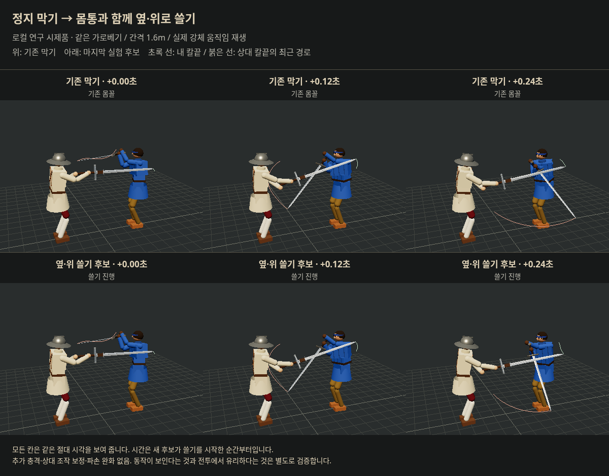

# 이베리아 동적 막기 1차 — 2026-10-18

사용자 실기 피드백: 앞선 목표 보정과 추가 충격은 유의미한 튕김 손맛이 없고, 추가 충격은 무기 파손이 지나치게 많았다. **직접 충격6 추천을 보류하고, 방어자의 몸꼴·손길 자체를 움직이는 연구로 전환한다.** 파손 증가는 사용자 관찰이며 이전 자료에서 정량 측정한 발생률이라고 주장하지 않는다.

결론: **일반 근육·손목 구동과 칼 충돌만으로 움직이는 막기는 구현 가능하다. 이번 다섯 경로 중 피해와 파손을 함께 개선했다고 채택할 후보는 없다.** 큰 쓸기는 전투 이득이 보장되지 않는다. 손맛은 새 후보에 대해 실제 인간 검증 전이다. 현행 본판·기존 공개 시험 링크에는 이번 시제품을 반영하지 않았다. 우화 발송도 하지 않았다.

## 출발점과 범위

- 연구 부모 `98519b1e`, `codex/iberian-beat-research-20261018`. 수신 기반은 이미 로컬에 확보한 `32b4dabaa0c2d3f2149d793e2b93516ba585db92`; 이번에 상대 최신 원격 동기화를 했다는 뜻이 아니다.
- `schools.js`의 탈류/레베스는 **쳐내기가 끝난 자세**를 정의한다. `frames.js installCover`가 같은 손·칼 방향을 매 프레임 덮는다. `PlayerParryGuard`의 패드 이동만 바꾸면 이 몸꼴 덮개에 가려질 수 있다.
- 따라서 연구 도구에서 검술 업데이트 뒤 **방어자의 손 목표와 칼 방향을 시간에 따라 연속 보간**했다. 마지막 후보는 골반·가슴 회전 목표도 움직인다. 실제 강체 순간이동·추가 충격·공격자 조작 보정·힘 배율·파손 예외는 없다. `combat.iberianBeat`도 제거한 상태로 측정했다.
- 보법·기력 공식·일반 게임 `src` 변경 없음. 이베리아 막기책이 있는 플레이어의 highL/highR만 대상. 다른 줄과 다른 유파는 원래 동작이다. 버튼 해제·공격·탈진 시 새 경로를 중단한다. 기존 덮개 해제 보간은 유지한다. AI에 이 경로를 직접 설치한 상호 대련 연구는 아직 아니다.

## 경로 후보

좌우는 기존 탈류·레베스에 맞춰 거울 대칭이다. 거리·각도는 목표값이며 실제 손·칼이 그 시간에 정확히 도달한다는 뜻이 아니다. 역사적 동작의 정밀 복원이라고 주장하지 않는다.

| ID | 시작 / 쓸기 | 시간 | 제한 |
|---|---|---|---|
| base | 기존 종료 몸꼴 | 기존값 | 비교군 |
| compact | 손 옆거리22→52cm, 칼 방위각 −14→24°, 아래 사선 | .36초 / 회수 .24초 | 기존 위협 감지에 시작 |
| broad | 손 옆거리 −2→57cm, 칼 방위각 −30→38°, 더 큰 아래 사선 | .44초 / 회수 .28초 | 기존 위협 감지에 시작 |
| carry | 기존 손40cm에서59cm로, 방위각6→34° | .28초 / 회수 .30초 | 실제 칼의 접근속도/거리로 시작, 재시작 최소 .7초 |
| guided | carry와 같은 경로 | 동일 | 접촉 뒤 추적 줄이 바뀌어도 기존 덮개가 남아 있는 동안 이어감. 새 위협은 우선 |
| lateral | 손40→55cm, 높이32→36cm, 칼 올림38→43°/방위6→30°, 골반12°·가슴22° 추가 회전 | .30초 / 회수 .30초 | guided와 같은 감지·중단 조건 |

접근 조건은 상대 칼65% 지점의 현재 위치·이동속도로 계산한다. 내 가슴을 향한 속도>.8m/s, 거리<1.4m, `(거리−.30)/접근속도 < .38초`. 곡선 공격의 충돌 시각을 정확히 예측하는 식이 아니며, 준비/회수 동작과 줄 전환에 대한 오차가 남는다. 상대 AI의 기술명·공격 단계·공격 번호를 새 경로의 판단에 읽지 않는다.

## 비교 규모와 결과

총144실행: 6군 × 단발12조건(6공격×거리1.4/1.6m) + 6군 × 최대30초12조건(2시드×상대3무기×베기/찌르기 반격 정책). 플레이어 츠바이핸더. **실제 사람이 플레이한144판이나 독립144표본이 아니다.** 입력 정책만 같고 물리가 갈라진 뒤 실제 입력 시각도 달라진다. 기존 비교와 같은 조건을 사용해 파손을 추가 계측했다.

단발에서 compact는 기존과 같은 누적 피해였으나 접촉 조건이9→7개로 줄었다. broad는 새로운 팔 베임3건이 생겼다. 단발 모든 군에서 양측 파손0으로, 이것만으로 파손이 안전하다고 판정할 수 없다.

아래 피해는 각 조건에서 **6군 중 가장 일찍 끝난 시점까지** 자른 실제 상처 변화량이다. 군당 공통 노출시간 합261.35초. 팔다리 기능 손실·의식 손상·출혈 속도 추가량을 임의 HP점수로 합산하지 않는다. 사망/파손 열은 각각의 전체 실행(최대30초) 종료까지이며 피해 열과 관찰 길이가 다르다.

| 경로 | 내 팔다리 손상 | 내 의식 손상 | 출혈 속도 추가량 | 내 사망 / 12 | 내 무기 파손 / 12 | 상대 파손 / 12 |
|---|---:|---:|---:|---:|---:|---:|
| 기존 | 기준 | 기준 | 기준 | 2 | 2 | 1 |
| 작은 사선 | +6% | +1% | −63% | 1 | 5 | 0 |
| 큰 사선 | +1% | +7% | −67% | 2 | 3 | 0 |
| 접근 연동 | +122% | +126% | +146% | 5 | 2 | 0 |
| 접근 연동 + 이어 쓸기 | +67% | +46% | +11% | 4 | 1 | 0 |
| 옆·위 + 몸통 회전 | +41% | +16% | −11% | 3 | 2 | 1 |

작은 사선은 출혈·사망에서 이득 신호가 있으나 자기 파손이2→5회다. 이를 무조건 나빠졌다고 단순화하지 않지만, 사용자가 지적한 파손 문제의 해결안으로 추천할 수 없다. 마지막 안은 파손이 같아도 피해가 늘었다. 표본 시드가2개뿐이고 파손 난수·조기 종료·상호 반응이 얽히므로 확정 발생률·승률로 일반화하지 않는다.

## 파손 원인과 이번 계측

`Fighter.absorbWeaponImpact(J, by)`는 충돌 때 무기별 `breakChance(J)`와 상대 무기 배율로 확률을 계산한 뒤 전용 난수를 굴린다. 확률은 충격이 커질수록 증가하다 기준 충격에서 포화된다. 큰 움직임은 별도 충격 코드 없이도 기존 접촉 충격이나 반복 접촉을 늘릴 수 있다.

앞선 추가 충격은 같은 프레임의 파손 함수에 곧장 더해지는 수가 아니다. 이후 강체 궤적과 재접촉을 바꿀 수 있으므로 그 경로로 파손이 늘었는지 따로 추적해야 한다. 사용자의 경험을 부정하거나 직접 원인을 확정하지 않는다.

이번에는 양측 실제 파손 시각, 파손 전의 매 충격 J와 조건부 파손 확률을 기록했다. 관찰기는 기존 함수에 같은 인자를 넘기며 난수를 추가 소비하지 않는다. `summary.json`의 probabilitySum은 노출된 충돌들의 조건부 확률 합일 뿐 전체 판의 파손 확률·독립 표본 기대값으로 해석하지 않는다.

## 동작 사진과 해석



실제 Rapier 강체 기록을 게임 캐릭터로 재생한 로컬 연구 화면이다. 전투 무대에서의 사람 플레이 사진은 아니다. 위·아래는 같은 절대 시각이며 추가 선은 실제 칼끝의 최근 .12초 경로다. 쓸기 시작과 접촉 시각을 혼동하지 않는다.

이 가로베기 예에서 첫 접촉은 쓸기 시작 약.09초 뒤다. 시작+.12초(접촉 직후) 내 칼끝은 기존과2.3cm 차이, +.24초에는11.5cm 차이다. 상대 칼과 가슴 중심의 거리는 각각 기존73.7→후보74.4cm, 기존138.6→후보126.8cm다. **움직임을 더 주어도 접촉 순간 변화가 작고 이후 상대 칼이 더 가까워질 수 있다.** 한 장면의 거리이며 안전 판정이나 전체 전투의 대리 지표로 쓰지 않는다.

## 다음 설계의 우선순위 — 아직 구현/검증된 해결책 아님

1. 뒤로 크게 빼는 준비 대신 현재 칼 위치에서 방어선으로 진입한다. 상대 칼이 닿을 때 이미 옆으로 이동 중이어야 한다. 목표 궤적뿐 아니라 실제 칼의 도달 지연을 기준으로 조정한다.
2. 내 칼의 손잡이에 가까운 부분이 상대 칼의 바깥 부분을 비스듬히 받아 나가도록 **접촉 위치·각도**부터 맞춘다. 정면 충돌 속도를 크게 하는 목표를 두지 않는다.
3. 접촉 이후에 크게 이어 쓸되 내 팔·가슴 앞으로 상대 칼을 되돌리지 않는 종료 경로를 찾는다. 쓸기 중 새 위협과 사용자 공격 전환을 막아서는 안 된다.
4. 성공 기준은 튕김 거리만이 아니라 약30초 피해·자기 파손·반격 기회와 인간 양쪽 역할의 체감이다. 막는 동작의 자동 타격이 공격 비용 없이 이득을 주는지도 본판 채택 전 별도 검증해야 한다.

이번에는 손길/몸꼴의 움직임이 물리 충돌에 반영된다는 것과 단순 큰 궤적의 부작용을 확인했다. 위 세부 접촉 제어와 실제 손맛까지 해결했다고 보고하지 않는다.

## 재현·검증

```
node tools/sim/iberian_dynamic_study.mjs probe
node tools/sim/iberian_dynamic_study.mjs live
python tools/sim/iberian_dynamic_summary.py
node tools/sim/iberian_dynamic_checks.mjs
node tools/browser/iberian_dynamic_record.mjs
```

`ONLY=base|compact|broad|carry|guided|lateral`로 부분 실행. 원자료는 `raw/`, 집계는 `summary.json`. 사진 재생 페이지는 `tools/browser/iberian_dynamic.html`이며 Vite에서 연다. 브라우저6패널/예외0 확인. 16초 기존군의 관찰 전후 체력·입력·접촉·결과 정확 일치, 버튼 해제 중단, 다른 유파/책 없음 미설치, 추가 충격 hook 없음 확인. 도구 전용 변경으로 일반 게임의5관문을 새로 실행했다고 주장하지 않는다. 원 연구144실행 외 이 구현검사/사진 재현 실행은 독립 실험 표본에 더하지 않는다.
