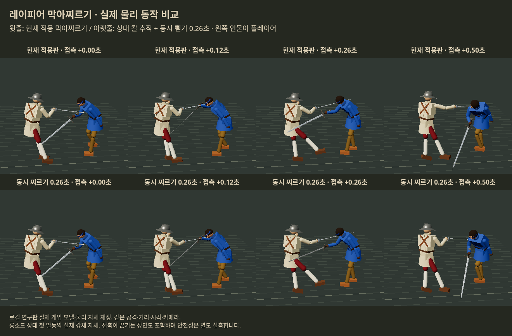
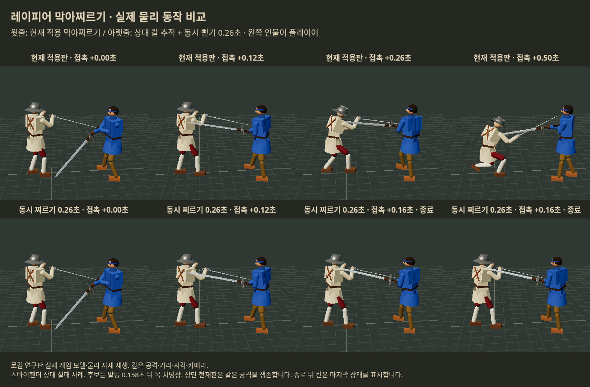

# 막아찌르기 2차 — 동시에 뻗으며 칼을 받치는 경로

2026-10-20 KST. **현재 적용판을 교체할 추천값은 찾지 못했다.** 첫 선별에서는 0.26초 후보의 안전성이 좋아 보였으나, 별도 24조건에서는 발동 후 5초의 피해와 치명상 문제가 남았다. 단순 속도 상향은 공격도 늘지만 받은 피해도 늘었다. 이는 30초 승패로 기각한 판단이 아니다.

우화의 제안 전체를 반증한 결과는 아니다. 이번에는 받침 삭제·뻗는 시간·접촉 위치를 따라가는 손 목표·가까운 팔 겨누기·포르테 제한을 분리했다. **능동적인 손목 회전, 입력 0.16초 두 단계, 추가 충격과 소리/불꽃은 아직 시험하지 않았다.** 새 효과를 모두 묶기 전에 손길 자체의 득실을 확인한 단계다.

## 평가 원칙과 범위

사용자 최신 지시: 발동 후 **1초·5초의 피해/반격**, 판당 발동과 자동 찌르기 상처를 주 지표로 삼는다. 30초 누적 피해와 최종 승패는 참고만 한다. 드문 기술을 판 전체를 바꾸지 못했다는 이유로 배제하지 않는다. 사지 손상·의식 손상·새 출혈률은 다른 단위이므로 합쳐 임의 점수를 만들지 않는다. 닿은 횟수보다 치명상과 손실 크기를 우선한다.

- 기준: 우화 main `9a8f4bcc14771d336c7ee75b9cea90bff7bc86c3`, 이미 직접 적용된 막아찌르기.
- 게임 루프와 실제 Rapier 물리 120Hz. 플레이어 자리에는 관측 가능한 칼 속도/접근 방향을 보고 막기를 누르고 접촉 뒤 찌르기를 시도하는 입력 대본, 상대는 실제 AI.
- 상대 무기 6종: 롱소드·우치가타나·츠바이핸더·청강검·레이피어·플랑베르주. 반응 지연 0.12/0.22초. 새 난수 조건을 나눴다.
- **비교 336회**: 선별 10안×12조건=120, 새 조건 7안×24=168, 결과를 본 후 각도/보정 상한 후속 2안×24=48. 후속 48회는 같은 검증 조건 재사용이므로 독립 재검증으로 부르지 않는다.
- 인간 입력 흉내를 낸 연구이며 **사람 손맛 시험이 아니다**. 행동 대본 하나·외양/방어구 한 조합·작은 표본의 한계가 있다.
- 생산 `src`, 공개 시험 링크, 원본 main, 우화 새 메시지는 변경하지 않았다. 앞선 직접 적용 허가는 그 한 건의 예외다.

## 꼴·길·값

현재판은 접촉 때의 손/칼 방향/몸 자세를 잡아 0.12초 받친 뒤 0.32초 동안 28cm 뻗고, 0.08초 끝 자세와 0.20초 회수를 둔다. 0.32초 입력창·정상 찌르기 비용·상대 공격당 1회는 전 후보에서 유지했다.

새 경로는 별도 받침 없이 방향 전환과 뻗기를 함께 한다. 자신의 칼 안쪽 절반에 놓은 목표 접촉점을 상대 칼 축에 투영하고, 그 점을 따라 손 목표를 횡방향 최대 12cm 보정한다. 상대 칼 위의 추적 구간은 최초 위치 ±25%로 제한한다. 22cm 이상 어긋난 상태로 접촉이 0.08초 끊기면 회수한다. **칼을 순간 이동시키거나 접촉을 강제하지 않으며 기존 팔/손목 힘으로만 목표를 쫓는다.** 물리적인 접촉 유지가 보장되는 장치는 아니다.

| 시험 | 바뀐 부분 |
|---|---|
| fast24 | 받침 없음, 0.24초 뻗기, 상대 칼 추적 없음 |
| bindslow | 현재의 0.12+0.32초에 추적만 추가 |
| bind22/24/26 | 받침 없음, 각 0.22/0.24/0.26초, 최대12cm 추적 |
| near26 | bind26 + 가슴이 최대 도달 거리 밖이면 가까운 아래팔 선택. 방향차45도 이내·10cm 이상 가까울 때만, 발동 뒤 표적 고정 |
| forte26 | bind26 + 자신의 칼 안쪽 절반/인접 코등이에서만 발동 |
| currentforte | 현재 손길에 같은 포르테 제한만 적용한 대조군 |
| release26 | 추적 보정은0, 멀어진 상대 칼을 보고 조기 회수하는 부분만 유지 |
| bind26full | 추적은 유지, 조기 회수 없음 |
| axis26 | 가슴 방향으로 도는 비중 65%→15%, 추적12cm |
| gentle26 | axis26에서 추적 상한12→6cm |

추적 중에는 최초 접촉 위치를 자신의 포르테 범위로 제한해 목표를 만든다. **그렇다고 실제 포르테-상대 약부 접촉이 성립했다고 간주하지 않는다.** 접점이 코등이/손잡이에 있거나 이미 끊긴 경우가 많다. 실제 손목 굴림/상대 약부 유지까지 완성된 경로라고 부를 수 없다.

## 주 결과: 발동 이후 1초와 5초

새 24조건 중 **첫 발동 시점과 발동 전 모든 상처 기록이 정확히 같은 14쌍**을 비교했다. 발동 자체가 달라진 판을 같은 사건인 것처럼 맞추지 않았다. 이후의 상처에는 자동 동작과 그 뒤 수동 반격 대본이 모두 포함된다. 첫 발동만 기준으로 잡아 창이 겹치는 중복 집계를 피했다.

| 첫 발동 뒤 | 현재판 | 빠른 뻗기 0.24초 | 칼 추적 0.26초 |
|---|---:|---:|---:|
| 1초 받은 사지 손실 합 | 0.561 | 1.293 | 0 |
| 1초 받은 의식 손실 합 | 0.524 | 0.648 | 0.532 |
| 1초 추가 출혈률 합 | 0.0561 | 0.0697 | 0.2781 |
| 1초 준 사지 손실 합 | 1.611 | 2.990 | 0.214 |
| 1초 반격 상처 / 반격한 쌍 | 12 / 6 | 13 / 7 | 11 / 7 |
| 5초 받은 사지 손실 합 | 1.233 | 4.315 | 2.667 |
| 5초 받은 의식 손실 합 | 0.778 | 1.242 | 0.532 |
| 5초 추가 출혈률 합 | 0.0695 | 0.3153 | 0.7416 |
| 5초 준 사지 손실 합 | 3.706 | 6.929 | 2.214 |
| 5초 반격 상처 / 반격한 쌍 | 29 / 11 | 32 / 11 | 19 / 9 |
| 5초 내 플레이어 사망 | 0 | 0 | 2 |

사지 1은 해당 사지의 정규화된 상태 1만큼 손실이며 여러 부위/여러 판을 합산했다. 의식은 별도 정규화 상태 손실, 출혈은 **흘린 혈액량이 아니라 상처로 새로 더해진 출혈률**이다. 출혈 기준 합이 작으므로 10배 같은 비율만으로 크기를 부풀리지 않는다. 표는 절대 합계를 함께 제시한다.

빠른 안은 첫 반격이 나온 판에서 첫 상처 중앙시각 0.225→0.075초로 빨라졌지만, 성공한 판만의 중앙값이므로 실패를 포함한 성공률이 아니다. 자동 동작 중 실제 찌르기 상처가 난 발동은 전체24조건 5/24→8/18로 늘었다. 그러나 **받은 사지·의식·출혈도 모두 늘어** 안전한 개선으로 추천하지 않는다.

칼 추적안은 자동 찌르기 상처가 난 발동이 5/24→5/20으로, 건수는 늘지 않았다. 실제 접촉 상태 기록의 평균 지속은 0.150→0.166초에 그쳤다. 동작이 짧아져 접촉 비율이 31→45%로 커지지만 이를 접촉 시간이 크게 늘었다고 읽으면 안 된다. 이 수치는 엔진의 칼 접촉 상태이며 지속 압력/포르테-약부 결합 시간의 증명은 아니다.

### 큰 피해 하나의 우연인가

14쌍 중 어느 한 쌍을 빼도 빠른 안의 5초 받은 사지·의식·출혈 증가는 남았다. 추적안도 받은 사지와 출혈 증가, 준 사지 피해 감소가 남았다. 따라서 나쁜 한 판만의 영향으로 전부 설명되지는 않는다. 다만 **적은 조건에서의 방향성 확인이지 통계적 확증/실제 사람의 승률 예측은 아니다.** 의식 감소 하나만으로 다른 치명상을 상쇄하지 않았다.

## 가까운 팔과 포르테 제한

- 가까운 팔 겨누기: 21발동 중6회 아래팔을 선택했지만 자동 찌르기 상처는5회로 추적안과 같았다. 같은14쌍 첫5초 반격 상처29→17, 플레이어 사망0→2. 이 목표 선택 규칙은 추천하지 않는다.
- 포르테 제한: 발동이24/24판→11/24판(평균1.00→0.46회)으로 감소했다. 제한만 적용한 현재 손길과 새 손길도 따로 비교했다.
- 양쪽 동일하게 포르테 제한을 건 **첫 발동 일치10쌍**: 첫1초 받은 의식0.185→0.164·출혈률0.00834→0.00214, 반격 상처9→10으로 작은 이득. 그러나 첫5초 받은 사지0.558→2.635·출혈률0.0179→0.4508, 사망0→1, 반격24→19로 뒤집혔다. **입구 제한만으로 새 경로의 안전성이 해결되지는 않았다.**
- 가슴 방향 회전을 줄인 후속: 받은 사지는 줄었지만 의식/출혈과 첫1초 치명상 문제가 남았다. 축 유지15%·6cm/12cm도 이번에는 채택하지 않는다.

## 실패 장면과 원인 범위





둘 다 실제 게임 모델을 실제 시뮬레이션 강체 위치/회전으로 재생한 브라우저 캡처다. 장식용 개념 그림이 아니다. 같은 공격/시드/입력/카메라. 실패안은 0.158초 뒤 목 치명상으로 판이 끝나므로 뒤 칸은 종료 상태를 표시한다. 원자료와 4개 재생의 상처/발동/최종 상태가 정확히 일치했다.

실패 사례(츠바이핸더,10303,지연0.12): 자신의 칼끝 부근(at≈0.996)과 상대 손잡이 뒤쪽(at≈−0.316)이 부딪힌 뒤 시작했다. 상대 칼날을 타는 관계가 아니다. 보정 필요량이36.7cm까지 커지고 조기 회수가 시작됐지만, 0.158초에 목 치명상을 막지 못했다. **길이가 긴 공격자의 손잡이를 따라가면 칼날을 계속 누른다는 가정이 깨질 수 있다.** 다만 경로/회수/후속 충돌의 인과를 각각 확증한 것은 아니다.

청강검 진단에서는 접촉 직후 칼이 부러져 길이가0.95→0.475m가 된 다음 접점을 투영해 at1.32가 나온 것을 확인했다. 계산 오류로 값만0~1에 잘라 ‘유효한 칼날 접촉’이라고 해석하면 안 된다. 코등이/손잡이/당일 파손 프레임을 구별해야 한다.

## 다음 구현의 구체적인 방향

현재 적용판을 유지한다. 다음 손길은 **상대 칼을 따라 손을 끌고 가는 것보다, 내 목·가슴 앞 방어면을 먼저 유지**하는 방향이 낫다.

1. 접촉 부품과 파손 전후 길이를 구별한다. 상대 손잡이·사라진 파손 부위에 닿은 상태에서는 ‘칼을 타기’를 시작하지 않는다.
2. 실제 자기 포르테와 상대 칼날의 교차가 유지되는 동안만 뻗는다. 손 목표보다 칼의 각도/아래팔 회전을 조정해 방어면을 남긴다. 강제 접촉·상대 순간이동은 사용하지 않는다.
3. 칼이 분리되면 반격을 취소하더라도 **일반 막기 경로로 즉시 이어지는 회수**를 따로 시험한다. 이번 ‘빨리 끝내기’만으로는 그 연결이 안전하지 않았다.
4. 그 경로가 단기 득실을 통과한 후 0.16초 입력 보상/작은 일회 충격을 독립 비교한다. 반복 프레임 충격으로 ‘1/3 세기’를 부풀리지 않는다.

이는 다음 설계 방향이며 구현/안전성 검증 완료 주장이 아니다. 우화의 방향을 폐기한 것이 아니라 이번 제한된 손길 구현을 채택하지 않는 결론이다.

## 참고 지표·검증·재현

새24조건 최종 플레이어/상대 사망: 현재4/16,빠른5/14,추적7/13. 이 숫자와30초 피해는 **추천 판단의 보조**다. 현재판이 모든 조건에서 우세하거나 밸런스가 완성됐다고 결론내리지 않는다. 30초 피해 비교는 양쪽 공통 관측 종료시간까지이며 조기 사망·최종 승패는 별도 보존했다.

`analysis.json`에 전 후보 절대값·1/5/30초·짝별 원자료·한 쌍 제외 분석·동일 포르테 대조군을 보존했다. 이벤트 시간은 입력 루프 시작시각, 발동은 같은 스텝 끝시각이라 분석 시 상처 시각에1/120초를 더해 맞췄다. 사망으로 창이 짧아진 판을 제외해 생존자만 비교하지 않는다.

`verification.json`: 후보 목표 유한값/단위방향/이동 상한, 상대 공격당 중복 발동0, 재생4건 정확재현, 브라우저 오류0. 원본 샘플은 업데이트 전 일반 막기 목표를 기록한 첫 줄이 있어 후보의 이동 상한 검사 대상에서 제외했다. 최초 검사 실패0.688m와 이유를 보존했다. 게임 수식을 바꿔 검사를 통과시키지 않았다.

```bash
python3 prepare.py /tmp/binding-reproduce --dependencies /workspace/halfsword-codex/node_modules
cd /tmp/binding-reproduce
POLICY=defensive VARIANT=bind26 SEEDS=10302,10303 OUT=raw/reproduced.json node tools/sim/binding_fight.mjs
python3 analyze_binding.py
python3 verify_binding.py
python3 -m http.server 4362 --bind 127.0.0.1
# 다른 셸에서 node capture.mjs / node capture-failure.mjs (Chromium/Playwright 경로는 설치 환경에 맞게)
```

시작·종료에 전일 일지 원격 발행 상태를 확인하며, 이번 결과는10/20 작성 노트에 남긴다. 전일 발행물을 덮어쓰지 않는다.
