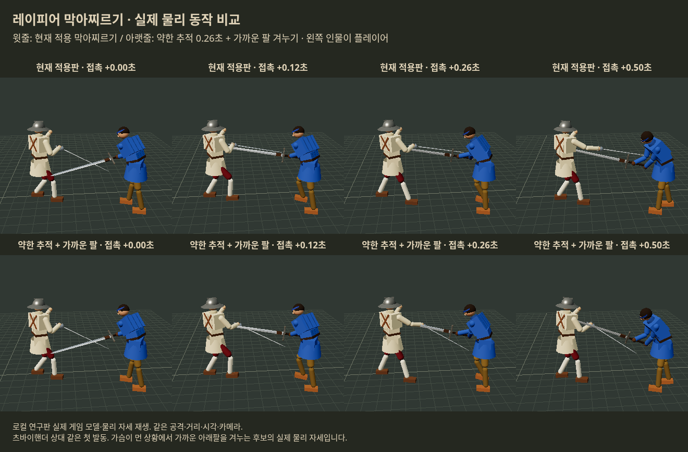

# 막아찌르기 3차 — 맞교환·손목·팔 겨누기·후퇴 입력

2026-10-20 KST. 사용자 승인 “필요한 추가 연구와 실험을 진행하고 보고해.”

**다음 인간 비교 후보는 `gentleNear`: 받침 없이 0.26초 뻗기 + 약한6cm 추적 + 가슴이 닿지 않을 때 가까운 아래팔 겨누기.** 서로 다른 새24조건 두 묶음에서 발동 뒤5초 사지 맞교환이 개선됐다. 손목 회전은 첫1초에 유용하지만5초까지의 이득은 덜 안정적이었다. 보정을 전부 합친 안이 더 좋지는 않았다.

**공세적으로 반격하는 경우의 후보이며, 물러서며 막는 플레이까지 개선됐다는 결론은 아니다.** 후퇴 때 급중단/완만한 회수도 추가 비교했지만, 현재판 대비5초 맞교환 손해를 모두 해소하지 못했다. 현재 게임 교체·공개 링크 배포·우화 새 메시지 발행은 하지 않았다.

## 기준과 실험 범위

- 최신 읽기 기준 원본 `9a8f4bcc14771d336c7ee75b9cea90bff7bc86c3`. 새 fetch에서도 연구 범위 소스 변경이 없었다. 기존 checkout에서 git 보존 소스를 `/tmp`에 풀어 연구했다.
- 1차 0.24/0.26 후보와2차 실패를 포함한 [이전 연구](../italian_binding_20261020/README.md)의 후속. 이전 시드10301~10303을 이번 효능 비교에 다시 쓰지 않았다.
- **준 피해−받은 피해**를 사지/의식/출혈 각각 계산한다. 내가 맞더라도 더 크게 돌려주면 이득으로 본다. 서로 단위가 다른 항목을 임의로 합치지 않고 치명상도 함께 본다.
- 발동 후1초·5초와 판당 발동이 주 기준. 30초 누적 피해/최종 승패는 참고만 한다.
- 실제 Rapier 물리120Hz, 최대30초. 상대6무기×입력지연0.12/0.22초×시드2=24조건. 새 조건묶음A=10304/10305, B=10306/10307.
- 플레이어에는 상대 칼의 관측 가능한 빠르기/접근 방향으로 막고 접촉 뒤 반격하는 입력 대본, 상대는 실제 AI. **사람 손맛 실험이 아니며 입력 대본·외양/방어구 조합의 한계가 있다.**
- 입력 방식 둘: `counter`=기존 반격 대본, `retreat`=첫 발동0.25초 뒤부터1.10초까지 막기를 누른 채 뒤 스틱0.65. 자동 기술이 끝난 뒤의 반격 선택도5초 결과에 포함된다. 움직임을 강제로 동일하게 고정한 기계적 순수 효과와 구별한다.
- 비교600회: 기본3안×입력2×24=144, 요소10안×24=240, 별도 확인4안×24=96, 확인 기본gentle26/후퇴near/후퇴급중단2안/후퇴완만회수=120. 이외 생명주기66검사·재생2건은 효능 표본에 합산하지 않는다.

## 추천값과 실제 동작

`gentleNear`는 우화의 ‘막으면서 찌르기’ 조언을 다음처럼 시험했다.

| 항목 | 연구 후보 |
|---|---|
| 입력/발동 | 현재판과 같은0.32초 입력창, 실제 들어오는 공격과 실제 칼 접촉, 공격당1회 |
| 받침/뻗기 | 별도 받침0, 28cm를0.26초 동안 뻗기 |
| 방어 각도 | 접촉 때의 칼 방향을 중심으로 유지, 목표를 향해 도는 혼합15% |
| 칼 추적 | 기존 손/손목 제어로 횡방향 목표를 최대6cm 보정. 강제 접촉/순간이동 없음 |
| 목표 | 가슴이 도달 거리 밖이고 아래팔이10cm 이상 가까우며 방향차45도 이내이면 아래팔 선택. 발동 뒤 표적 고정 |
| 끝 자세/회수 | 끝0.08초, 회수0.20초. 상대 칼이22cm 이상 벗어나고0.08초 접촉이 끊기면 조기 회수 |
| 비용/힘 | 기존 정상 찌르기 비용(막기 비용 포함), 추가 힘/추가 피해/상대 제어 저하/추가 충격 없음 |

시간은 기력 감속 전 명령 시간이며 실제 동작에는 기존 attackSpeed가 적용된다. 28cm는 손의 추가 뻗기이지 무기의 전체 도달 거리나 명중 보장이 아니다. 가까운 팔은 아래팔 중심 하나를 겨눈 시험이며 모든 신체 점 중 최적점을 찾는 완성된 조준기가 아니다. 포르테-상대 약부 접촉도 강제하지 않는다.



위=현재판, 아래=추천 후보. 츠바이핸더10307/지연0.22의 같은 첫 발동에서 실제 게임 강체 위치/회전을 재생한 브라우저 캡처다. 이 사례는 가까운 팔 분기가 실제 선택됐다. 게임 정식 반영 화면이 아니라 연구판 물리 재생이다.

## 추천을 뒷받침하는 두 묶음

발동 시각과 발동 이전 모든 상처가 동일한 **A10쌍/B11쌍**의 첫 발동만 비교했다. 첫 발동 뒤의 창을 중복 집계하지 않았으며 사망한 판도 제외하지 않았다. 모든 조건이 발동하지 않아24조건 전체를24번 발동으로 세지 않는다.

사지 맞교환 = 준 사지 손실 합−받은 사지 손실 합. 양수는 상대에게 더 많이 준 것이다.

| 조건 | 현재판 첫1초 | 후보 첫1초 | 현재판 첫5초 | 후보 첫5초 |
|---|---:|---:|---:|---:|
| 새 묶음A,10쌍 | +0.183 | +1.173 | +0.342 | +2.296 |
| 별도 묶음B,11쌍 | −1.207 | +0.635 | +0.347 | +4.939 |

어느 한 쌍을 빼도 두 묶음의 사지 맞교환 개선 방향은 남았다. 다만 작은 표본의 민감도 검사이며 통계적 우위 확정은 아니다. B는 후보를 고른 뒤 별도로 시험했으므로 A와 구별해 제시한다.

B의 첫5초 절대값:

| 항목 | 현재판 | 후보 |
|---|---:|---:|
| 준 사지 손실 | 2.719 | 5.663 |
| 받은 사지 손실 | 2.372 | 0.723 |
| 받은 의식 손실 | 1.587 | 1.136 |
| 준 추가 출혈률 | 0.6387 | 0.6336 |
| 받은 추가 출혈률 | 0.0582 | 0.0190 |
| 반격 상처 / 반격이 나온 쌍 | 17 / 7 | 22 / 9 |
| 플레이어 / 상대 사망 | 1 / 2 | 1 / 1 |

사지1은 정규화된 사지 상태1만큼 손실, 여러 부위/조건을 합산했다. 출혈은 흐른 피의 총량이 아니라 상처로 새로 더해진 출혈률이다. 사지 이득이 마무리 사망 횟수 개선과 같은 말은 아니다. B의 의식/출혈 이득은 특정 조건에 민감하고 첫1초 의식 손실은0.012 늘었다. A 첫5초는 세 항목의 맞교환 모두 개선됐으나 의식은 한 조건을 빼면 방향이 바뀐다.

두24조건 묶음 전체48판 기준(발동 빈도 기술통계): 현재30발동→후보33발동, 판당0.625→0.688회. 자동 동작 중 실제 찌르기 상처가 난 발동은6→11회. 발동과 같은 스텝의 이미 난 상처를 빼도6→11이다. 사람 손맛 또는 보장 명중률로 해석하지 않는다.

## 우화 조언별 결과

### 받침 삭제와 빠른 뻗기

빠른0.24초 단독은 A 첫5초 사지 맞교환이 현재보다1.425 나빠지고 출혈도 악화했다. 반면 약한추적0.26초는 A 첫5초 사지+0.273·의식+0.345·출혈+0.122, B 사지+3.901·의식+0.451·출혈+0.0337. 따라서 이번 범위에서는 **단순 속도 상향보다0.26초의 방어 각도 유지와 약한 손 보정이 더 유망**했다. 시간·회전·추적이 결합된 경로 비교이므로0.02초 차이 하나가 원인이라고 주장하지 않는다.

### 가까운 팔 겨누기

약한추적 기본안과 직접 비교한 추가 사지 맞교환 이득: A 첫5초+1.682, B +0.691. B의 첫1초는 같았다. 팔 분기는 A15발동 중4회, B18발동 중2회라 매번 이득을 주는 기능은 아니다. 이미 가슴을 찌를 수 있는 상황에서 팔로 억지로 낮추지 않는 조건부 선택이 유용한 후보가 됐다.

### 손목 회전

접촉 때의 칼 면을 기준으로 상대 칼을 받치는 방향의 날 세우기 목표를20°/40° 상한으로 조정했다. 첫0.10초에 섞으며 기존 손목 토크·관절 한도를 그대로 사용했다. `driveSword`의 기존 막기 칼 면 목표를 연구 중에만 전달하고 호출 뒤 소유 상태를 복원한다. 손목을 물리적으로 순간 회전시키거나 팔 힘을 올리지 않았다. 목표40°가 실제 관절이 항상40° 돈다는 뜻은 아니다.

A에서40°는 첫1초 사지 맞교환+0.665, 첫5초+2.849였다. 별도B에서도 첫1초+1.879가 남았지만 첫5초+0.039로 거의 사라지고 출혈 맞교환은−0.132가 됐다. **순간 방어/반격 보조의 가능성은 있으나 기본 후보에 무조건 더할 근거는 부족하다.** 20°안은 A 자동 동작 중 찌르기 상처0회였고 후속5초 이득이므로 자동 찌르기 개선과 혼동하지 않는다.

팔 겨누기+40°의 조합도 B 첫5초 사지+0.933에 그쳐, 팔 겨누기 단독+4.592보다 작았다. 각 보정의 이득이 더해진다고 가정하지 않는다.

### 막기로 돌아오기

일반 회수 때 기존 막기 입력 패드를 계속 움직이게 하여, 자동 자세의 무게가 내려가면서 현재 막기 자세로 이어지도록 했다. 빠른24의 첫5초 맞교환은 좋아졌지만, 추천 후보보다 명확한 우위는 없었다. 약한26의 첫1초 사지/출혈 이득은 있었으나 첫5초 의식 맞교환은 악화했다.

### 0.16초 정확 입력 두 단계

0.16초 이내는 새 빠른 손길,0.16~0.32초는 현재 느린 손길로 나눴다. 약한26 두단계의 A 첫5초 사지 이득+0.072로 단일안+0.273보다 작았다. 느린 분기가4/15발동(빠른24에서는3/16)뿐이다. **실력 보상·손맛은 이번 대본으로 검증하지 못했고, 전투 수치만으로 두 단계 채택을 추천하지 않는다.**

### 작은 바깥 충격

원본 이베리아와 같은 손 포함 유효질량 공식으로, 발동 때 딱1회 상대 칼 축 위에 충격을 주고 반작용은 내 가슴60%/골반40%가 받았다. 계수1.6의1/3인0.533, 더 작은0.267 두 값을 분리했다. 매 프레임 주지 않으며 상대 팔 힘은 그대로다. 0.533은12발동/12충격,0.267은16/16이었다.

A 첫5초 맞교환은 일부 개선됐지만 손목/팔겨누기보다 사지 이득이 작았다. 0.533은 첫1초 의식 맞교환이 나빠졌고,0.267도 첫1초 사지 맞교환이 나빠졌다. 이24조건에서는 파손 급증이 없었지만 안전성을 일반화하지 않는다. 중앙 충격량은 각각3.61/1.85 N·s이며 전투가 달라져 최고값은 작은 계수 쪽이 더 클 수 있다. **우선 추천안에는 추가 충격을 넣지 않는다.**

## 남은 약점: 물러서면서 막기

후퇴 입력A10쌍의 첫5초 사지 맞교환:

| 동작 | 준−받은 사지 손실 | 현재판과 차이 | 플레이어5초 사망 |
|---|---:|---:|---:|
| 현재판 | +3.778 | 기준 | 0 |
| 약한추적+팔겨누기 | −0.050 | −3.828 | 0 |
| 후퇴 시 즉시 중단 | +1.785 | −1.993 | 2 |
| 후퇴 시0.20초 회수/막기 연결 | +2.468 | −1.310 | 0 |

즉시 중단은 기존 현재판에도 같은 조건을 적용한 대조군을 뒀다. 새 손길을 갑자기 끊으면 막기 복귀가 안전하다고 보장되지 않았다. 부드러운 회수는 즉시 중단의 의식/치명상 손해를 줄였지만 현재판의 사지 맞교환에는 못 미쳤다. 따라서 후퇴 분기를 해결했다고 보고하지 않는다.

이 결과는 ‘플레이어는 후퇴하면 안 된다’는 뜻이 아니다. **자동 공격을 주는 기능이 후퇴 선택에 부담을 줄 수 있다는 한계**다. 인간 비교에서는 전진 반격과 후퇴 방어 양쪽을 반드시 확인해야 한다. 새로운 범용 막기 상향으로 정식 반영하기보다는 공세형 후보로 비교할 단계다.

## 검증·운영·재현

- 생명주기22검사×팔겨누기/손목/충격3안=66통과. 해제·수동공격·탈진·중복 청구·이동 보존·정상 종료 등. 합성 접촉을 사용하는 생명주기 검사는 효능 표본이 아니다.
- 목표18,970샘플 유한값/단위방향, 손목2,656샘플 유한값, 공격당 중복발동0, 발동당 추가충격 최대1회 확인.
- 실제 재생2건의 상처/발동/최종 상태가 효능 원자료와 정확히 같고 브라우저 오류0.
- `analysis.json`에1/5/30초·절대값·짝별 상처·한쌍 제외 민감도·요소별 대조군 비교 보존. 사건 시간은 상처가 루프 시작/발동이 스텝 끝이라1/120초 보정한다. 조기 사망한 판을 표본에서 빼지 않는다.
- 30초/최종 사망은 참고: 반격A 현재6/15(플레이어/상대)→후보5/17, B8/13→8/14. 이것을 추천의 주 근거로 쓰지 않았다.
- 연구 자료와10/20 작성 노트만 보존한다. 전일 일지 원격 발행을 시작/종료 점검하며, 우화 실제 열람/채택을 추정하지 않는다.

```bash
python3 prepare.py /tmp/opposition-followup --dependencies /workspace/halfsword-codex/node_modules
cd /tmp/opposition-followup
POLICY=defensive AFTER=counter VARIANT=gentleNear SEEDS=10306,10307 OUT=raw/reproduced.json node tools/sim/followup_fight.mjs
python3 analyze_followup.py
python3 verify_followup.py
VARIANT=gentleNear node --test tools/sim/followup_checks.test.mjs
python3 -m http.server 4363 --bind 127.0.0.1
# 다른 셸: node capture.mjs (Playwright/Chromium 경로는 설치 환경에 맞게)
```

추천값은 시험한 범위의 인간 비교 후보이며 최적값·종합 우위·인간 손맛을 확정한 수치는 아니다.
