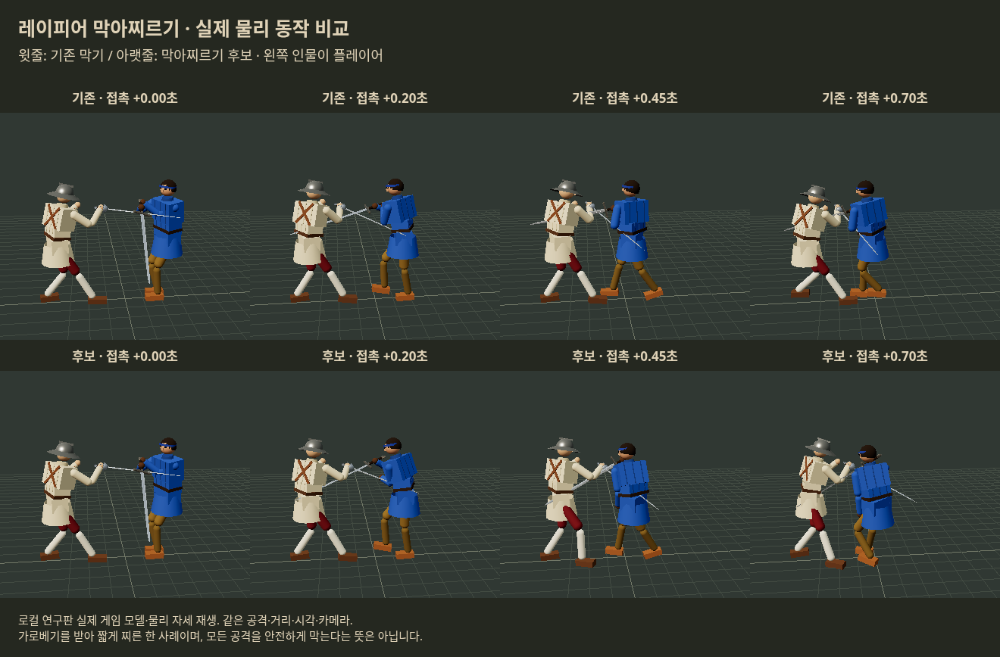

# 이탈리아 막아찌르기 · 2026-10-20 KST

**판단: 실제 물리로 작동하는 인간 시험 후보를 찾았다. 정식 상향·완성된 막기로 채택한 것은 아니다.** 우화 최신 `3e1eeebad80060f5cf516d9d89d9037ffab18c60`의 격리 사본에서만 연구했다. 생산 src, 공개 게임, 우화 메시지는 변경하지 않았다. 중정/마야 행동 수정은 사용자 결정대로 우화의 작업으로 둔다.

## 설계와 후보값

임시명 **막아찌르기**. 막기 버튼을 적시에 누른 다음 실제로 들어오는 칼과 접촉하면, 그 순간의 칼·손·몸 자세에서 짧게 찌른다. 기존 이탈리아 비기의 ‘상대 준비에 선제 찌르기’와 다르다. 그냥 보통 찌르기를 호출하면 방어가 풀리는 문제를 피하려고 별도의 물리 목표 덧씌우기를 쓴다.

| 항목 | 인간 시험 추천값 / 동작 |
|---|---|
| 입력 창 | 새 막기 입력 뒤 **0.32초** 안의 실제 칼 접촉 |
| 몸꼴 | 기존 막기 순간의 골반·몸통 기울임 유지. 새 극단적인 몸 비틀기 없음 |
| 손길 | 손을 뒤로 당기지 않고 칼자루를 바깥으로 최대4cm 받침. 현재 칼 방향에서 상대 가슴 방향으로 차이의65%까지 완만히 겨눔 |
| 받침·정렬 | **0.12초** |
| 뻗기 | **0.32초에 손 목표28cm**. 실제 손/칼 이동은 근육과 충돌이 결정함 |
| 끝 받침 / 회수 | 0.08초 / 0.20초, 정상 기력 기준 총0.72초 |
| 기력 | 같은 상대 공격의 막기3 + 추가찌르기4 = 기준7×원래 무게 배율. 시험 레이피어 실제2.49+3.32=5.80 |
| 중복 방지 | 한 번 누름·상대 공격 번호당1회. 누르고 있기/연타로 같은 공격 재발동 불가 |
| 조작 | 자동 전진 없음. 스틱 유지, 막기 해제·명시 공격·탈진·넘어짐·무장 상실 시 취소 |

부가 문턱은 접근 충돌 속도0.6m/s 이상, 실제 활성 공격 번호, 가슴 거리1.85m 이내, 직전0.08초 양의 severity 상처 없음이다. 이 부가값은 이번에 각각 최적화한 값이 아니라 준비 중 스침·실패 후 자동 돌진을 막는 초기 안전조건이다. 일반 막기 성공률 자체를 올리거나 무적/피해 감소를 주지는 않는다. 힘·추가 충격·피해 계수·유파 보법은 그대로다. 피로 시 동작 시간은 현행 기력 감속을 따른다.

## 비교 설계와 결과

실제 사람 시험이 아니다. 사람 역할은 막기 버튼과 이동/찌르기 입력을 쓰는 프로그램이며, 상대만 실제 AI다. 공격 경로 진단과 30초 전투를 구별한다. 모든 군에 같은 상대·난수·반응 지연을 짝지었다. 선별 결과를 새 조건의 성공으로 바꾸어 말하지 않는다.

- 경로 선별: 고정 공격32조건에서 기존/보통찌르기/방향유지/중간/직접/느린 경로6군. 느린 경로의 반격·방어 균형을 우선했다.
- 별도 공격48조건: 다른 무기3종, 좌우 베기/찌르기, 거리1.45/1.75m, 입력 시각2종. 이후 발동 조건 개정·길이 보정에도 사용했으므로 최종안의 완전히 미사용 검증 자료는 아니다.
- 입력 창80조건: 0.24/0.32/0.40초에서 각각17/26/27회 발동. 0.40초는 추가 기회가1회뿐이어서0.32초를 추천했다.
- 30초: 여섯 상대 무기(롱소드/우치가타나/츠바이핸더/청강검/레이피어/플람베르주), 반응지연0.12/0.22초, 선별 난수2개24조건 + 새 난수2개24조건. 공격 관측은 칼끝 속도/접근 방향이며 AI 미래 공격명을 읽지 않는다. 방어 위주 대본은 실제 칼 접촉 후 반격을 시도하고, 조건에 따라 접근한다.
- 초기 공격적인 대본24조건에서는 발동이1회뿐이었다. 이 결과로 기술의 전투 이득을 판단하지 않고 원자료로 보존했다.

최종28cm 후보와 기존의 **48조건**:

| 결과 | 기존 | 후보 |
|---|---:|---:|
| 플레이어 패배 | 11 | 8 |
| 상대 패배 | 29 | 33 |
| 후보 발동 | — | 44회 / 22판 |
| 자동 동작 중 실제 찌르기 상처 | — | 13회 / 발동44회 |

13회에서 첫 상처까지 중앙0.267초. 대상은 몸통뿐 아니라 팔다리·머리도 포함한다. 자동 동작 밖의 수동 반격과 섞어 세지 않았다. 피격/죽음 등으로 실제 판 길이가 다르므로 피해는 **두 군이 모두 살아서 비교 가능한 공통 시간**까지 별도 집계한다. 누적 출혈 항목은 혈액 총손실이 아니라 상처가 새로 더한 출혈률의 합이다.

| 구간 | 받은 팔다리 손상 | 받은 의식 손상 | 새 출혈률 | 준 팔다리 손상 |
|---|---:|---:|---:|---:|
| 첫 발동 뒤1초,22짝 | 0 → 0.101 | −15.4% | 0 → 0.00173 | −53.5% |
| 첫 발동 뒤5초,22짝 | −17.4% | **+8.0%** | −61.1% | +19.4% |
| 전체 공통시간,48짝 | **+2.6%** | −9.9% | −4.9% | +6.7% |

**처음1초의 즉각 반격은 기존 수동 반격보다 약했다.** 5초에는 받은 팔다리 피해/출혈과 준 피해가 개선되지만 의식 손상은 늘었다. 전체 패배 수는 줄었으나 새24조건만 보면 패배4→4, 받은 팔다리+11.6%·의식+17.8%·출혈+4.7%로 악화했다. 결과는 표본·대본에 민감하고 통계적 우위는 확정하지 않았다. 사람의 입력 선택과 손맛을 확인할 후보라는 결론이다.

## 다른 안과 실패 기록

- 일반 찌르기 연결: 같은 마지막 발동 조건의24조건에서 패배7→6, 공통시간 팔다리 손상+16%. 첫1초 공격 이득은 컸지만5초 받은 팔다리·의식 손상이 늘었다. 방어를 유지하는 경로의 대조군으로 보존.
- 빠른 중간 경로(0.08+0.24초,28cm): 첫24조건은 유망했지만 새24에서 상대 패배17→14, 공통시간 받은 팔다리+19.3%. 느린 안보다 우선하지 않는다.
- 짧은20cm 경로:48조건 패배8판으로28cm와 같지만 공통시간 팔다리 손상+35.8%. 짧게만 하면 안전해진다는 가정이 성립하지 않았다. 제외.
- 긴36cm 경로: 공격 대본에서는 준 피해가 늘기도 했지만 일반 대련까지 확대할 근거가 부족하여 추천하지 않음.
- v1: 내부 defend 판정+fresh 접촉 요구. 실제 접촉을 놓쳐 초기에 발동이 드물었음.
- v2: 실제 접촉 중심으로 바꾸고 상처 직후 제외·공격별 중복 방지 추가. 준비 중 공격번호0 접촉도 발동한 오류 발견. 수치를 최종안에 합산하지 않음.
- v3: 활성 공격 번호까지 요구해 준비 중 발동 제거. 최종 추천 및48조건은 v3.
- 초기 캡처 코드의 괄호 오류1건을 수정 후 실행. 결과 없는 실패를 실험 판수로 세지 않음.

최종48조건 실제 무기 파손은 플레이어0→0, 상대6→5였다. 무장 상실(팔 손실·놓침 포함)과 파손을 구별했다. 최초24조건은 파손 필드가 없어 관찰 필드만 추가해 재실행했고, 기존 상처 사건/종료시각이 정확히 같음을 확인했다.

전체 수행량은 짧은 공격 대본784회+최대30초 대련408회=1,192회다. 48개 최종 전투 조건의 여러 후보/오류수정/검증 실행을 포함하며 독립된1,192개 사람 전투가 아니다. `batches.json`으로 실제 실행과 단순 재집계를 구별한다.

## 실제 화면



윗줄 기존/아랫줄 후보, 같은 가로베기·거리·카메라·시각이다. 접촉 시점부터0.70초까지의 한 사례. 실제 게임 모델과 시뮬레이션의 강체 상태를 재생한 로컬 연구 화면이며, 일반 게임에 이미 적용된 화면이 아니다. 녹화 원자료는 압축 보존한 `replay.json`에 있다.

## 원본·재현·검증

- `source.json`: 원본 커밋과 파일별 SHA256, 실험 모듈 세 버전 해시. `source-files.tar.gz`: 해당 원본의 src/시뮬 도구/패키지 고정본.
- `raw-results.tar.gz`: 원시JSON, 입력 조건·실패/검증 로그, 물리 재생. `analysis.json`: 집계와 짝 비교. 통합표용 combined-*는 기존 결과의 재집계이며 새 실행이 아니다.
- `tools/italian_opposition_research*.js`: 버전별 실제 구현. 게임 생산 코드에 연결하지 않음.
- 생명주기 검사: 막기 해제/탈진/명시 공격 중단, 같은 공격 재발동 금지, 스틱 보존, 추가비용3.3166 확인. 합성 접촉 검사는 기능 검증이며 전투 성공률에 포함하지 않음.
- 첫24조건 중 실제 발동12짝은 첫 발동 접촉의 속도·거리·접근 방향·시각과 그 이전 상처 기록이 정확히 같았다.
- 브라우저 실제 렌더 오류0. 사람의 플레이와 모바일 조작성 검증은 아직 없다.

```bash
python3 docs/research/italian_opposition_20261020/prepare.py /tmp/opposition-reproduce
cd /tmp/opposition-reproduce
CASES=cases-all.json VARIANT=slow OPTIONS='{"window":0.32}' OUT=raw/repeat-probe.json node tools/sim/opposition_probe.mjs
POLICY=defensive SEEDS=8301,8302,9411,9412 VARIANT=slow OPTIONS='{"window":0.32}' OUT=raw/repeat-fight.json node tools/sim/opposition_fight.mjs
node tools/sim/opposition_checks.mjs
python3 analyze.py
```

이전 버전은 prepare.py의 `--version 1`/`2`로 복원하며 각 raw JSON의 options와 cases 파일을 사용한다. 초기3.4m 공격 대본은 `opposition_fight_v1.mjs`, 후속은2.2m 방어 대본이다. 전체 복사본을 추출하더라도 변경한 파일은 별도 연구 모듈/도구뿐이다. 이식 시에는 막기 입력의 상승 에지, Skill 물리 목표 갱신 순서, Combat 실제 칼 접촉, Stamina 공격 번호/막기 비용 연결을 함께 검토해야 한다. 설치하지 않으면 완전히 기존 게임이다.

## 일지

10/19 일지의 정시 발행 누락을 시작 점검에서 발견했다. 당시 마감 이전 작성 원고를 지연 발행했고, `de56d8bb3846db071c02e3dda081c115c036c9ec`의 MD/JSON을 fresh HTTPS Git으로 검증했다(`publication-receipt.json`). 정시 발행으로 표시하지 않는다. 이번 연구는10/20 KST 작성 노트에 기록한다. 우화에게 새 연구 메시지를 보낸 것은 아니다.
