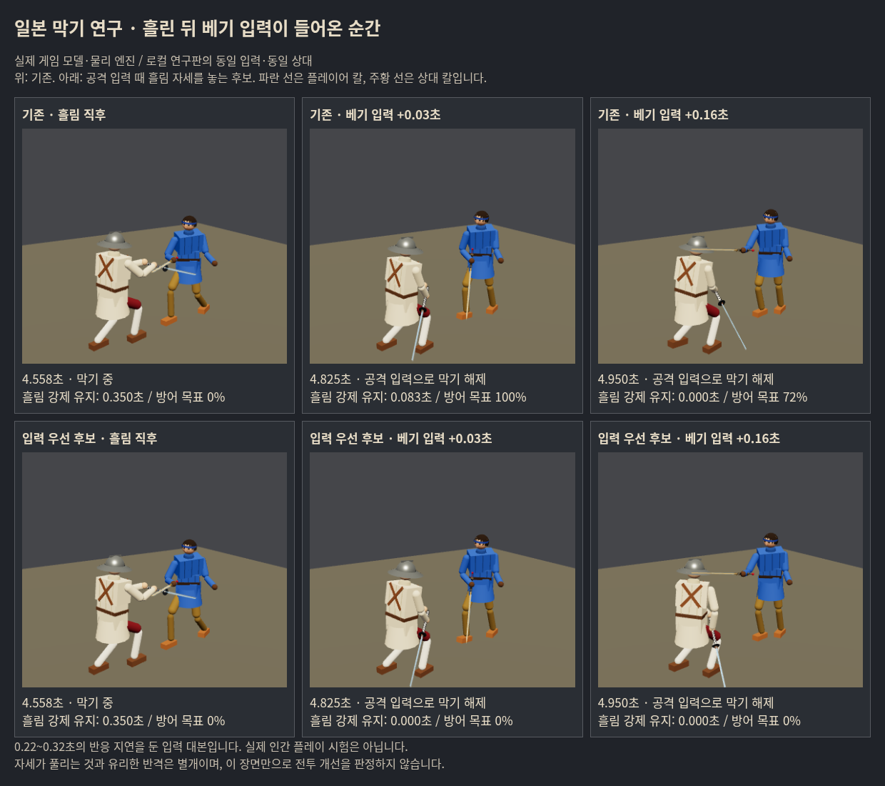

# 일본 막기 1차 · 흘림 빈도와 인간 반격 연결

사용자 “이제 일본 막기 연구 진행해.”에 따른 연구. **6개 보정 후보를 비교했으나 기본 게임에 적용할 종합 개선안은 아직 없다.** 입력 간섭을 하나 확인했고, 이를 없애는 것만으로 반격 이득이 생기지는 않았다. 실패한 후보·원자료도 보존한다.

기준 `c7c2131e` (우화 수신 코드 `89a0996c` + 직전 연구 전달 묶음). 가지 `codex/japanese-parry-flow-20261017`. 이번에는 우화 원격을 새로 읽거나 메시지를 보내지 않았다. src/공개 자산/패키지/엔트리는 기준과 동일하며 모든 변경은 연구 도구·기록이다.

## 판단 기준과 표본

- 일본의 목적은 평균적인 일반 방어에 **가끔 흘리고 사람이 다음 동작을 고를 실제 이득**을 더하는 것. 동방처럼 높은 방어율이나100% 막음이 목적이 아니다. 고노센 자동 연결·추가 피해·기절을 넣지 않았다.
- 인간의 조작·약30초 종합 득실을 우선한다. 아래는 플레이어 명령 대본과 상대 AI의 물리 대전이며 **실제 인간 플레이 테스트가 아니다**. 상대 AI의 모드/공격 번호는 기록에만 쓰고 입력 결정에는 쓰지 않는다.
- 움직이는 칼을 보고0.16~0.32초 뒤 막기, 접촉 뒤0.22~0.32초 지연으로 찌르기/베기. 반격은 ‘흘림 성공’ 내부 플래그를 몰래 읽지 않고 실제 새 칼 접촉에 반응한다. 발은 거리와 약한 옆 이동 대본이다.
- 최대30초, 사망하면 종료. 우치가타나 대 롱소드·청강검·츠바이핸더, 방어/찌르기 반격/베기 반격. 독립 씨앗511–514×3무기×3정책=36조건씩. 씨앗4개를 반복한 조건이며36명의 독립 사용자가 아니다.
- 실제 main처럼 기력 controller를 연결했다. 책·보법 켬, 막는 동안 회복 정지/공격 청구 유지. AI 대 AI 대련으로 플레이어 이득을 대신하지 않았다.

[사전 기록과 추가 가설/입력 정정](../../design/japanese_flow_prereg_20261017.md) · [계산 결과](report.json) · [원자료 목록/해시](raw-manifest.json).

## 1. 드문 발동과 작은 후속 이득은 별개 문제

독립 기준36조건의 관측 합804.47초:

| 관측 | 결과 |
|---|---:|
| 새 칼 접촉 전체(공격 중 포함) | 756 |
| 막기 버튼이 손을 제어하던 접촉 | 408 |
| 실제 흘림 충격 적용 | 14 |
| 흘림0회인 조건 | 26/36 |
| 흘림 순간 우케나가시 목표 가중치≥0.5 | 4/14 |

막기 중408접촉에서 수직 하강속도3.5m/s 미달359, 낮은 접점157, 자기 칼끝이 위139였다. **겹치는 조건**이며 합해서 실패 수로 세지 않는다. 14회 모두 실제 충격량>0. `cover` 가중치는 목표 덧씌움이지 물리 자세 도착을 증명하는 값이 아니다.

상대 AI 단계는14흘림 중 follow11/defend2/withdraw1이었다. follow 중에도 실제 칼날은 공격할 수 있으므로 이것만으로 ‘이미 늦은 발동’이라고 단정하지 않는다. 다만 목표 읽기·칼 도착·접촉이 잘 맞지 않는다는 기존 연구의 문제는 남아 있다.

독립 자료에서 순서상 처음 흘림이 있었던4조건을 골라 **그 순간까지 동일한 물리 이력(해시 일치)**에서 흘림 켬/끔을 비교했다. 상대 칼끝이 자기 몸 앞 방어 구역에0.1초 머무르기까지:

| 조건 | 끔 → 켬 | 의미 |
|---|---|---|
| 511 롱소드·방어 | .817 → .900초 | 추가 .083초 |
| 511 츠바이핸더·찌르기 | 둘 다1.2초 관측 안 복귀 없음 | 지연 차이 미확정 |
| 512 청강검·찌르기 | .008 → .008초 | 추가 없음 |
| 513 롱소드·찌르기 | .275 → .275초 | 추가 없음 |

이4건에서는0.2초 이상의 **추가** 반격 여유를 입증하지 못했다. 몸 앞 복귀는 위치 대리 지표이며 실제 반격 명중 보장이 아니다. 창 안 실제 적용 상처도 함께 저장했다. 이 조건부4건을 전체 판당 기대값으로 환산하지 않는다. 이전 우화의38사례 연구에서도 실제 빈틈 증가는 일부였다는 결과와 방향이 같다([기존 기록 §12-3](../../strike/ukenagashi_talho_2026-10-17.md)).

## 2. 비교한 후보

| 후보 | 바꾼 점 | 선별 결과/판단 |
|---|---|---|
| diagonal | 실제 다가오는 사선 접촉에서 하강3.5→1m/s, 전체 속도≥3.5 | 추가 발동 기회0. 기준과 결과 동일 |
| diagonal-strong | 위 조건+흘리는 계수.8→1.2 | 사망4→5/8. 세게 밀기 채택 안 함 |
| roof-path | 관측 칼날 경로가 중앙 상체/팔에 접근할 때만 기존 지붕 꼴 유지 | 사망4→7/8. 동방 경로 판독을 일본 지붕에 곧바로 쓰는 안 채택 안 함 |
| glance | 접촉면에서 칼끝 방향으로 이미 미끄러지는 속도/각도 조건 | 기준8조건 결과 동일. 조건을 더 푸는 근거 없음 |
| release | 버튼 해제/공격 때 강제 자세 시계만 종료 | 찌르기 포함8조건 사망4→4, 출혈·기능 손실 증가. 부분 조작 후보 |
| free-cut | **공격 입력 때만** 강제 시계와 방어 목표 덧씌움을 함께 해제 | 베기 입력 간섭 제거. 다음 독립 검사에서 득실이 갈림 |

선별은 방어/찌르기48조건과 정정된 베기12조건, 독립 비교72조건. 실패 후보마다 큰 전체 검사를 반복하지 않았다. 작은 선별의 사망 차이를 통계적으로 확정된 밸런스 차이라고 부르지 않는다.

## 3. 확인한 입력 간섭과 독립 결과

흘림은 `forceT=.35`로 우케나가시 목표를 유지한다. 버튼의 막기 제어가 공격 입력 때문에 꺼져도 `frames.js`가 그 목표를 계속 덧씌울 수 있다. 찌르기 중에는 덮기를 건너뛰지만 시계도 진행하지 않아 **찌르기 뒤 잔여 자세가 다시 나올 수도 있다**. 코드와 실제 입력 검사로 확인했다.

실제 물리 재현 장면(502/청강검/베기):4.550초 흘림,4.792초 베기 입력. 기존은 이후14물리 스텝(약.117초) 동안 강제 시계가 남았고 그 뒤에도 목표 무게가 서서히 줄었다. 후보는 공격 시점부터 이를 해제한다. **칼이 순간이동하거나 .117초 동안 완전히 멈췄다는 의미가 아니다**. 팔·칼은 계속 물리 운동을 하며 방어 목표와 공격 목표가 경쟁한 것이다.

독립36조건씩의 결과:

| 지표 | 기존 | free-cut |
|---|---:|---:|
| 전체 사망 | 17/36 | 17/36 |
| 방어 위주 사망 | 5/12 | 5/12 |
| 찌르기 반격 사망 | 5/12 | 4/12 |
| 베기 반격 사망 | 7/12 | 8/12 |
| 상대 처치 | 1 | 1 |
| 무기 상실 | 9 | 9 |
| 평균 혈액 손실(끝 시점) | 19.71% | 19.68% |
| 평균 누적 팔다리 기능 손실 합 | .889 | .864 |
| 평균 누적 의식 손실 | .509 | .507 |
| 흘림 | 14 | 14 |
| 반격 명령 | 149 | 146 |
| 평균 막기 기력 | 15.55 | 15.41 |
| 평균 공격 기력 | 31.05 | 30.68 |

누적 기능/의식 손실은 실제 `applyWound` 전후 변화이며 HP나 충돌 에너지 합이 아니다. 사망으로 노출이 짧아지면 피해도 작게 보일 수 있어 각 쌍의 공통 관측 시간까지 누적 피해를 별도로 계산했다.36쌍 중 실제 피해 결과가 달라진 것은5쌍이다.

- 찌르기514/롱소드: 기존 사망→후보 생존. 같은 관측 시간 누적 의식 손실1.567→.553, 팔다리2.167→1.125로 실제 이득.
- 베기511/롱소드: 기존 생존→후보28.8초 사망. 같은 관측 시간 의식.875→1.826, 팔다리1.413→2.013으로 실제 손해.
- 전체 평균이 약간 좋아 보인다는 이유로 출시하지 않는다. **인간 입력 존중은 개선했지만, 핵심인 흘림→유리한 반격을 확보하지 못했고 베기 사용자의 손해가 남는다.** 반대로 이 후보를 영구 폐기하지도 않는다. 더 자연스러운 전환을 조사할 근거로 보존한다.

## 4. 검증·정정·한계

- 기력 연결·일반 입력 정책을 둔 기준 계측은 생산 `PlayerParryGuard`/`Combat.nagashi` 직접 실행과3조건의 피해·명령·기력·상태가 정확히 같았다. 다른 유파/막기 책 없음2조건도 후보와 기준 동일. 설정 값 복구 확인.
- 실제 게임 페이지에서 버튼/키/탭·회복·공격 해제 등20검사 통과, 브라우저 예외0. 강제 시계 검사는 상태를 주입한 **입력 진단**이고 자연 발동 빈도 검사로 세지 않았다.
- 첫 브라우저 검사2번째 페이지는 전투 시작 시간 대기 중90초 초과. 로그를 보존했다. 입력 전용 검사에서 상대 AI를 처음부터 정지하도록 고친 뒤 두 페이지를 재검사했다. 최초 실패 원인을 확정했다고 하지 않는다.
- 실제 화면2조건의 피해·기력·명령·흘림은 Node 재현과 동일. 렌더러의 난수가 전투 난수에 섞이지 않게 분리했다. 사진은 개발용 중립 배경이며 공개 게임 배포 화면이 아니다.
- 초기 베기 대본은 끌기가 끝난 직후 막기를 다시 켰지만 실제 main은 `swinging`이 끝나기까지 끊김을 유지한다. v4에서 바로잡고 해당 선별/독립 베기36조건을 다시 수행했다. v3 원자료는 `raw`에 보존하되 최종 통계에서 제외했다. 방어/찌르기 대본은 같아서 기존 결과를 재사용했다.
- 생산 소스/자산 변화0. 직전 최신 기준의5관문 검증을 재사용했고, 이번 빌드/새 도구 구문/실제 입력·화면 검사를 추가했다. 이 검증을 후보의 밸런스 채택 근거로 대신하지 않는다.
- 새로운 일반 AI 제어 변경이나 일본 AI 상대 강화는 적용하지 않았다. 향후 공통 흘림 규칙을 채택할 때에는 일본 AI 강화로 플레이어 이득이 상쇄되는지 별도 비교해야 한다.

## 5. 다음 우선순위

단순히 발동 문턱을 낮추거나 미는 힘을 더 키우는 것보다 **실제 접촉 순간부터 반격 입력까지의 손·칼·몸 전환**이 우선이다. 지금 꼴이 반격에 필요한 칼 방향과 맞는지, 필요한 경우 기존 우케나가시를 보완하는 전환 몸꼴을 고안할 수 있다. 이것은 아직 검증하지 않은 다음 가설이며 자동 공격/비기 연결 제안이 아니다.

접촉 전 준비, 실제 흘림, 버튼을 쥐고 유지하기, 사람이 공격으로 나가기의 네 구간을 따로 본다. ‘몸꼴 무게1’과 실제 도착을 구별하고, 반격의 피해뿐 아니라 그 공격 때문에 새로 노출되는 팔/목의 피해까지 같은30초 안에서 비교한다. 기존 실패 후보의 시간/힘만 바꿔 큰 반복을 하지 않는다.

## 재현

1. `raw/*.json.gz`를 별도 디렉터리에 풀고 `python tools/sim/japanese_flow_report.py <디렉터리>`를 실행하면 `report.json`을 재생성한다.
2. 독립 재생: `KINDS=base,free-cut SEEDS=511,512,513,514 ATKS=longsword,qinggang,zweihander POLICIES=reactive,riposte,slash LABEL=rerun node tools/sim/japanese_flow_live.mjs`.
3. 시각 재현: Vite를4197포트로 실행한 뒤 `node tools/browser/japanese_flow_capture.mjs`. 입력은 `japanese_flow_input_probe.mjs`, 생산 계측 동등성은 `japanese_flow_compat.mjs`.
4. 제거/되돌림: 연구 페이지·어댑터를 열지 않으면 생산 동작 그대로다. 이번 커밋을 되돌려도 기본 게임 코드 변경은 없다. 우화 전달은 사용자 검토 뒤 별도 지시에 맞춰 최신 수신판 동기화부터 수행한다.
