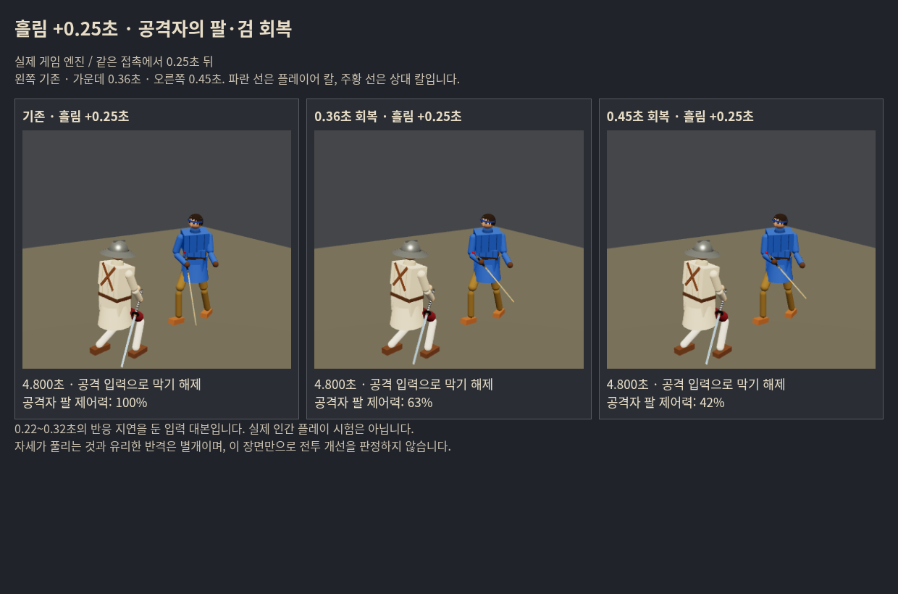

# 일본 흘림 뒤 짧은 회복 지연 · 인간 시험 추천안

기준702e6fde. **추천 시험값0.36초**, 확정 출시값/자연스러움의 실측 최대값 아님. 사용자는 매번 결정적일 필요 없이 차이가 느껴지고 공격자에게 까다로운 흘림을 원했다. 기존 발동 조건·미끄러뜨리는 힘·보법은 유지한다. 우화 전달은 하지 않았다.

## 무엇을 바꿨나

기존 흘림이 양의 충격으로 성공했을 때 **흘림당한 사람**의 두 팔과 손목 제어력을 잠시25%로 낮춘다.0.36초 중 처음0.12초는 그 상태, 다음0.24초는 부드러운 곡선으로100% 복귀. 전신 정지·속도/위치 직접 변경·이동 잠금·입력 삭제·추가 피해·고노센 자동 연결 없음. 칼은 실제 관성과 충돌대로 움직인다. 같은 공격 번호는 한 번만, 회복 중 재접촉은 기간을 늘리지 않는다. 인간/AI 공통.

방어자가 공격 입력을 낼 때 남은 흘림 자세가 반격을 덮던 문제도 해제한다. AI는 attack 전환 때 같은 강제 목표를 놓는다. 이 보완만 적용한 별도 대조군을 두었다. 모든 연구 기본값은 끔이며 실제 시험 페이지에서만 켠다.

## 비교 결과

새611–614씨앗×상대 롱소드/청강검/츠바이핸더×찌르기/베기, 각24조건. 최대30초 또는 어느 쪽 사망까지. 실제 입력·기력·상처를 사용하는 명령 대본이며 인간 플레이 시험이 아니다. 동일한4씨앗의 반복이므로24명의 독립된 사람처럼 해석하지 않는다.

| 지표 | 기존 | 입력 전환만 | 입력 전환+0.36초 |
|---|---:|---:|---:|
| 플레이어 사망 |16/24|16/24|13/24|
| 상대 처치 |0|0|0|
| 평균 혈액 손실 |32.49%|31.41%|27.74%|
| 평균 누적 팔다리 기능 손실 |1.1132|1.1152|0.9326|
| 평균 누적 의식 손실 |0.7048|0.6881|0.5494|
| 흘림 발동 조건 수 |8/24|8/24|8/24|
| 흘림 횟수 |13|13|10|

**구제된3조건은 모두612씨앗**(롱소드 찌르기, 청강검 찌르기/베기). 신규 사망0이나 표본/씨앗 편중이 크다. 상대에게 입힌 평균 팔다리 손상은0.1900→0.1676으로 오히려 줄었다. 반격 보장/공격력 상승 효과가 아니라 이번 표본에서는 방어 결과 개선이 두드러졌다.

사망 뒤 노출 차이도 구분했다. 각 짝의 세 조건이 모두 관측된 시간까지만 실제 applyWound 변화량을 합치면 팔다리 손실1.0763→0.8435, 의식 손실0.6370→0.5363. 반면 **추가 출혈률 누계는0.1528→0.1692로 증가**했다(잃은 혈액량과 다른 지표).612 롱소드 찌르기는 살아남았지만 팔다리 누적 손실0.9683→2.4046. 이득과 손해를 함께 보존했다. 전체 순이득은 유망하지만 인간 체감 검토 전 확정하지 않는다.

## 왜0.36초를 먼저 권하나

이미 알려진 실제 흘림6장면에서0.18/0.24/0.30/0.36/0.45초와 두 대조군을 비교했다.42조건 모두 첫 흘림 전 상태 해시 일치. 이들은 선별 장면이며 일반적인 발동률의 분모가 아니다.

0.18초는 물리적 차이가 나도 되돌림 지연이 작은 장면이 있었다.0.36초는 잔여 제어력과 검 궤적에 차이를 주고 위 새 표본에서 생존 결과가 개선돼 **상한 쪽 인간 시험 후보**로 골랐다.0.45초는502 청강검 장면에서 검의 몸 앞 복귀가 관측창 안에 사라진 반면0.36초는0.400초였다(입력 전환만0.317초). 길게 늘리면 손실 범위가 급격히 커질 가능성이 있어 추천 기본값으로 올리지 않았다.

단, **검이 몸 앞을 지나는 시간은 공격 가능한 시간과 다르다.** 다른3장면에서는 팔 힘이 줄어 떨어지는 검이 오히려 더 일찍 몸 앞을 통과했다. 이를 반격 지연/자연스러움의 직접 증거로 쓰지 않는다.0.45초의30초 전투 안전성을 별도 검증한 것도 아니다. 최종 최대값은 사용자가 공격자와 방어자 양쪽에서 확인한다.



## 공격자 시험과 링크

일반 일본 AI를 상대하는 내려베기 대본12조건씩은 양쪽 모두흘림0회. 따라서 **공격자 체감·불이익의 안전성 근거가 아니다**. 이를 숨기지 않고 별도 반복 연습을 마련했다. 상대는 기존 머리 위 우케나가시 자세를 유지하며 실제 물리 충돌/속도/기울기 조건으로만 흘린다. 강제 발동이 아니다.

고정 방어 연습4조건씩(681–682×롱소드/청강검)은 청강검2조건에서 기존10회/후보8회 발동, 후보의 인간 역할에8회 회복 지연. 상대가 공격하지 않는 연습이므로 생존/일반 AI 밸런스 근거로 세지 않는다. 초기1.75m 거리의 대본은 사거리 밖이라0회였고,1.35m로 가까이 들어가는 연습 대본만 이 수치에 사용했다. 초기 자료도 보존했다.

공개 시험은 `encounters/japanese-recovery-20261017/` 하위의 독립 게임 묶음. 위 ‘비교 설정’에서 방어자/공격자, 기존/입력 전환만/각 시간, 보통 대련/반복 연습을 전환한다. 실제 기존 게임 입력(막기·드래그·탭·이동)을 사용한다. 공격자 기본 무기는 실제 연습 발동을 확인한 청강검이다. 흘림 횟수는 실제 nagashi 반환을 센다.

- 방어자: 막기 뒤 수동 공격이나 거리 이탈에 여유가 생기는가?
- 공격자: 멈춘 인형처럼 보이지 않으면서 다시 검을 돌리는 일이 성가신가? 이동·막기 입력은 계속 되는가?
-0.36초가 과하면0.30초, 약하면0.45초와 비교한다. 길게 할수록 유리하다고 가정하지 않는다.

시험판의 저장은 탭 안 임시 메모리로 격리, 계정/여정 저장과 서비스 워커 등록을 공유하지 않는다. 일반 공개 게임 소스·물리값은 교체하지 않는다.

## 검증·재현

- 실제 브라우저 양 역할의 시작/시간 변경/재시작·회복 중 이동+막기·회복 완료·저장 분리 검사 통과, 최종 페이지 오류/HTTP 실패0. 합성 회복 상태 주입은 **입력 연속성 검사만**이며 자연 발동 표본이 아니다.
- 실제 몸으로 활성화 시 선속도/각속도/위치 동일, 중복 연장 없음, 새 공격 재발동, 이동0.363m/제어력 복구 확인. 다른 유파 및 일본 막기 책 없음은 같은 전투 결과/명령, 발동0.
- 기본 끔5관문 통과. fights12/live_battery/finish_thrust/weapon_smoke stdout은 이전c7c2131e 검증 로그와 byte동일. corr_s0 12/12동일. 무기검사FAIL/NaN0.
- 독립 연구 빌드 성공. 처음 빌드의 닫는 괄호 누락을 수정했다. 첫 브라우저 검사는 iframe 자동 전체화면이 상단 비교 단추를 가려 실패; 시험 iframe의 전체화면을 금지하고 양 역할 재검사 통과. 최초 실패 로그 보존.
- 초기 선별은 일부 실제 발동 시점보다12초 종료가 빨랐음. 그42조건은 예비 진단으로 보존하고, 기존 발동 시각+약1.3초까지인6장면42조건으로 다시 비교했다. 첫 흘림 전 SHA256동일을 확인했다.
- 원자료는 `raw/`와 SHA256대장, 계산표는 `report.json`. 최대30초 독립72조건, 일반 공격자24조건, 고정 방어8조건을 서로 다른 분모로 보고한다.

```sh
PHASE=screen-window node tools/sim/japanese_recovery.mjs
PHASE=independent VALUES=base,0,0.36 node tools/sim/japanese_recovery.mjs
node tools/sim/japanese_recovery_attacker.mjs
PRACTICE=1 node tools/sim/japanese_recovery_attacker.mjs
node tools/sim/japanese_recovery_checks.mjs
python tools/sim/japanese_recovery_report.py
node tools/browser/build_japanese_recovery.mjs
python -m http.server 4198 --directory /tmp/japanese-recovery-lab
node tools/browser/japanese_recovery_smoke.mjs
```

재현 보고 도구는 압축 원자료를 OUT 경로에 풀어 실행할 수 있다. 기본 게임 되돌림은 필요 없다(기본 끔/공개 게임 소스 그대로). 후보 제거는이 커밋의 combat/fighter/frames 연결과 nagashi_recovery.js를 함께 되돌린다. 시험 링크 제거는 public/encounters의 해당 폴더만 지운다. 우화에게 보낼 경우 최신 수신판 동기화와 사용자 검토 후 전달 규약을 적용한다.
