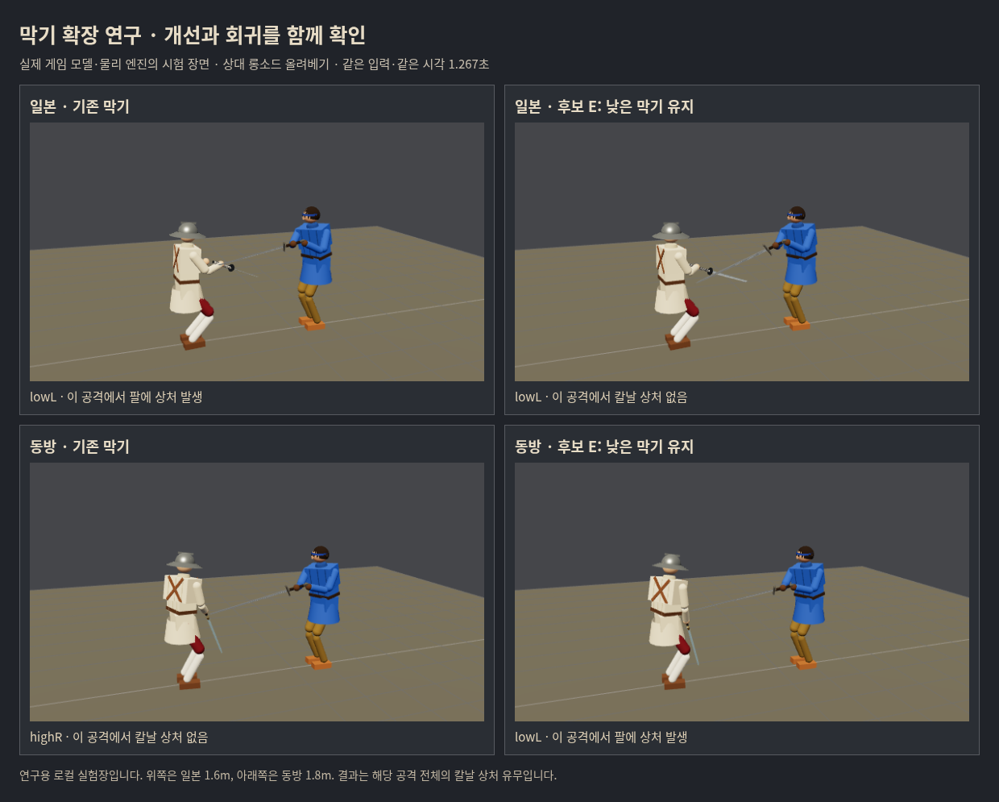

# 막기 읽기 확장 실험 · 2026-10-17

**12개 후보를 검토했다. 특정 올려베기에는 개선을 찾았으나, 전체 막기와 흘려 받기를 개선한 출시 후보는 아직 없다. 게임 적용은 보류한다.**

사용자의 ‘자율적으로 문제 해결을 위한 확장된 실험’ 승인으로 수행했다. 우화 main을 다시 확인한 기준은 `f21266d6bcb3c44c02e0bd365a68cda5416ad6d1`. 1차 결과 `73158abe` 다음, `codex/parry-reading-research-20261017`에서 연구 도구만 변경했다. 유파 자세·보법·막기 손속도·무기/몸 물리·NAGASHI 및 게임 엔트리는 그대로다. 우리 공개판/우화 저장소 변경과 새 메시지 발송은 없다.

[사전 가설·수치·중간 결과 뒤의 추가 실험 기록](../../design/parry_extended_prereg_2026-10-17.md) · [재계산한 모든 수치](report.json) · [원문 성공기준](../../design/parry_reading_research_2026-10-17.md)

## 가장 중요한 판단

1. **손의 목적지와 실제 칼의 도착이 어긋나는 문제는 실제로 있다.** 다만 막기 줄을 오래 고정하면 속임수 대응을 잃거나 다른 부위를 열기도 한다. 시간 하나를 늘리는 공통 수정은 권하지 않는다.
2. **일본의 낮은 왼쪽 막기를 실제 칼이 올라올 때까지 유지하는 E2는 작은 개선 후보로 남긴다.** 같은228조건에서 칼날 부상17→15, 새 부상0, 가장 흔한 대각선 베기 악화0. 하지만 새로운 실제AI 검사에서는 상처92→91, 흘림 접촉35회당1회로 원래 목표15회당1회에 미달한다. ‘막기 성공률이 전반적으로 좋아졌다’고 홍보할 근거는 부족하다.
3. **피해 무효 대련에서 덜 베였다고 생존도 좋아지는 것은 아니다.** 양쪽 낮은 막기에 적용한 E는 독립AI 상처136→119였지만, 실제 피해를 켠 한 씨앗에서 기준60초 생존/후보39.558초 목상처 사망으로 갈렸다. 생존·치명 부위·실제 노출 시간을 따로 봐야 한다.
4. **기존 B의 접촉13회를 고정 분모로 쓰는 목표는 물리 경로 변화와 충돌한다.** 막기 시점을 시험 시간표로 제공해도 원래13접촉이 사라지고 다른11접촉이 생겼다. ‘몸꼴이 적용된 접촉 수’와 ‘원래 위험한 공격을 막은 수’를 계속 분리해야 한다. 공식 기준을 통과한 것으로 바꾸어 보고하지 않았다.

## 실제 엔진 비교



게임 모델·Rapier 물리로 촬영한 로컬 실험장이다. 공개 스테이지 화면이나 그림으로 만든 시안이 아니다. 양쪽은 같은 공격/시작 상태/시간이다. 위는 일본1.6m, 아래는 동방1.8m. 낮은 줄 유지 E는 일본의 팔 상처를 피하지만 동방에서는 없던 팔 상처를 만든다. 캡처 시점에 일본 양쪽 표기가 모두 lowL여도 **그 직전 움직인 경로가 다르다**. 사진 한 장의 줄 이름만으로 원인을 판단하지 않는다. 브라우저 예외/실패 응답0.

## 원인 분리

1차 후보 H3b의 회귀/구제10조건을 각각 기준과 후보로 재현하고, 기존120Hz 감각 기록에 내 손 목표·실제 칼 시작점/끝점·몸꼴 목표를 추가했다.

- **속임수**: 일본/롱소드 위→다리1.2m에서 기준은1.117초 lowL로 바꿔 상처를 피했다. H3b는1.408초까지 highC를 유지해1.342초 배/골반을 베였다. 같은 속임수1.4m에서는 오히려 유지가 구제했다. 공격 이름만으로 정답 줄을 고정할 수 없다.
- **칼 종류**: 레이피어 내려베기1.6/1.8m는 손이 위에서 시작해도 실제 칼이 낮은 찌르기 방향으로 들어온다. 중앙 위 손 입력을 그대로 내려베기로 취급하면 기준에 없던 팔 상처가 난다.
- **올려베기**: 일본/롱소드1.6m에서는 실제 칼이 아직 아래에 있는데 손 입력이 중립·위로 이동하면서 막기가 lowL→highC→highR 등으로 움직였다. 낮은 줄을 잠시 유지하면 상처를 피했다.
- **중립 구간의 별칭**: `coverFor`의 중립 point와 highC가 같은 패드 객체인 유파에서는 active-follow가 highC로 해석될 수 있다. 그러나 중립을 그대로 유지하거나 point로 명시하는 수정도 실제 물리에서 일부 대각선/속임수 방어를 악화시켰다. 단순한 코드 정리로 안전하게 고칠 수 있는 문제로 보지 않았다.
- **재취득**: 막기 줄이 사라져도 같은 위협 번호가 남아 재취득하지 않는 구간이 있다. 같은 위협에서 줄이 없으면 다시 읽는 H는 선별 부상 변화0, 실제AI 흘림8→4/상처 에너지 증가로 개선 후보가 아니었다.

## 후보 선별

11개 후보는 각각116조건: 8공격×2간격×7구성112 + 이전 회귀/구제4조건. 기존 기준판 결과를 재사용했다. 마지막 E2는 E의 범위를 사후 한정한12번째 후보다. 아래 ‘신규’는 기준에서 다치지 않았는데 후보에서 다친 조건, ‘구제’는 그 반대다.

| 후보 | 읽기 변경 | 신규 / 구제 | 판단 |
|---|---|---:|---|
| D central | 이미 잡은 highC·중앙 손·실제 높은 칼에만 유지, 옆 이동/낮아짐/찌르기는 해제 |1 / 3|동방 내려베기 회귀|
| E rise | 기존 낮은 줄에서 위로 긋기 시작, 실제 칼이 낮으면 유지 |0 / 2|전체 A/독립 조건/실제AI로 확대|
| D+E hybrid | 두 규칙 결합 |1 / 5|동방 내려베기 회귀|
| F danger | 가까운 미래에 몸으로 들어오는 칼 구간 동안 기존 줄 유지 |1 / 0|제외|
| G neutral | 손 중립 구간에서 follow 줄 교체 보류 |3 / 2|대각선 포함 회귀|
| G+E | 중립 보류+낮은 줄 유지 |3 / 2|제외|
| G+D+E | 중립 보류+두 유지 규칙 |3 / 5|대각선 포함 회귀|
| G2 neutral-point | 손 중립을 highC가 아닌 point로 처리 |5 / 3|제외|
| G2+E | 명시적 point+낮은 줄 유지 |4 / 7|동방/일본 회귀|
| H reacquire | 같은 위협에서 defLine이 없어지면 재취득 |0 / 0|실제AI 개선 불충분|
| H+E | 재취득+낮은 줄 유지 |0 / 2|E와 같은 선별 개선, 별도 전면 확대 안 함|

E의 수치: 손 속도4.5m/s 상승 가장자리, 위 성분>3m/s, 이미 잡은 lowL/lowR, 실제 칼끝<내 가슴+.1m일 때 유지. 칼끝>가슴+.25m, 찌르기 위협, 상대 거리>무기 도달거리+.9m 또는 .5초 상한에서 해제. 버튼을 놓거나 막기 불가 상태이면 즉시 해제한다. 각 값의 근거/후보별 다른 값은 사전 기록에 있다. AI의 공격 이름·대본 phase·미래 상태는 후보 입력으로 쓰지 않는다.

### E 전체 절반 A

19공격×4간격×공격무기3종=방어 구성당228조건. 원문의456조건 공식 검사와 구별한다. 부상은 베임/찌름을1회 이상 받은 조건이며 둔타 전체를 뜻하지 않는다. 가중치는 원문 공격 빈도를 그대로 사용하고, 헛침도 분모에 남긴다.

| 방어 구성 | 기준 | E | 신규 / 구제 | 가중 차이(%p) |
|---|---:|---:|---:|---:|
| 일본 |17|15|0 / 2|−1.416|
| 이베리아 |25|25|0 / 0|0|
| 동방 |17|17|1 / 1|+.214|
| 독일 |21|21|1 / 1|0|
| 이탈리아 |14|13|0 / 1|−.708|
| 무유파 |24|24|1 / 1|0|
| 일본 몸꼴 없음 |16|15|1 / 2|−.708|

대각선 zornhau 좌우 신규부상은0. 동방은 롱소드 올려베기1.8m 신규, 츠바이핸더 왼 올려베기1.8m 구제. 독일/무유파는 롱소드 올려베기1.4m 신규, 츠바이핸더 올려베기1.2m 구제다. 합계만 같다고 모든 조건이 보존된 것은 아니다.

처음 쓰는 간격1.3/1.5/1.7/1.9m·속도8/14m/s·준비 대기.05/.30초·6공격×3구성의288조건도 기준/후보로 검사했다. 일본18→15, 독일23→23, 동방30→28, 신규부상0. 대본의 일반화는 일부 확인했지만 실제 대련의 일반화와 구별한다.

### 실제AI · 피해 무효와 실제 피해를 구별

플레이어는 정지해 막기만 누른다. 공격자는 보통 롱소드AI. ‘상처’는 칼날 상처 이벤트 수로 한 번의 충돌이 여러 부위에 상처를 낼 수 있다. 피해 무효는 **플레이어에게만** 적용했으므로 공격자 사망으로 일찍 끝나는 판도 있다.

| 검사 | 칼날 상처 기준→후보 | 새 칼 접촉 / 흘림 기준→후보 | 관측 시간 기준→후보 |
|---|---:|---:|---:|
| E 씨앗1–10 |211→182|950/16→876/14|1200→1178.4초|
| E 독립 씨앗11–15 |136→119|503/5→533/6|600→600초|
| H 씨앗1–5 |115→109|461/8→501/4|600→600초|
| E2 새 씨앗16–20 |92→91|393/7→350/10|489.842→489.842초|

E 훈련 검사는 노출 시간이 다르므로 총 상처 감소율을 그대로 실력 향상으로 읽지 않는다. 분당 상처는10.55→약9.27. E 독립 검사는 같은600초에서 상처/에너지가 감소했지만 흘림 목표에는 미달했다.

**E 실제 피해 씨앗11–15, 60초 상한**: 기준1명 생존/후보0명 생존. 나머지4씨앗은 같은 결과다. 달라진11번에서 후보는28.525초 lowR 유지가 발동한 뒤 경로가 갈리고39.542초 목상처,39.558초 사망했다. 기준은60초까지 살아 있었다. 한 판으로 일반 생존률 차이를 추정하지 않지만 안전한 공통 적용을 지지하지도 않는다. 전체 상처31→29를 개선으로 주장하면 사망으로 줄어든 관측 시간을 숨기는 오류다.

### 마지막 한정 후보 E2

좌우 몸꼴과 물리는 대칭이 아니다. E에서 일본 구제는 lowL, 실제 피해 회귀는 lowR였으므로 **일본 막기 책/몸꼴의 lowL만** E와 같은 규칙으로 유지했다. 값은 재조정하지 않았다. E 결과를 보고 고른 범위이므로 씨앗1–15를 E2의 독립 검증으로 재사용하지 않았다.

- 일본228조건:17→15, 신규0, 가중−1.416%p. 구제는 롱소드 올려베기1.4/1.6m.
- 정수리 B26조건도 별도 재검사: 부상1/칼 충돌13/몸꼴≥.5 충돌0/흘림 발생9로 기준과 동일하다. 원래의 정수리 막기 목표는 해결하지 못했다.
- 새 씨앗16–20: 흘림 빈도56.1→35접촉당1회지만 상처92→91/에너지5999.7→5965.6J로 사실상 비슷하다. 씨앗19는27→31상처,20은14→9. 나머지3은 미발동이며 동일하다. 상처 없는 일방 개선이 아니다.
- 실제 피해 씨앗16–20: 후보 발동0, 두 버전 모두 같은 시각에 사망했다. **생존 안전성이 검증됐다는 뜻이 아니라, 유효 비교 표본이 없었다는 뜻이다.**
- 버튼 놓기/재누르기32판, 준비만48판, 다른 유파/막기 책 없음/몸꼴 없음5판: 놓은 동안 유지0, 준비만 하는 동안 새 유지0, 범위 밖 발동0. 놓기 시험에서는 한 조건만 상처를 구제하고 신규부상0. 총85판.

E2는 보존할 만한 부분 후보지만 현재 목적의 출시 해답은 아니다. 실제 플레이어가 느끼는 성공률·생존·흘림 개선을 주장하지 않는다.

## 머리 위 막기 시점만 정확하면 해결되는가

읽기를 제거한 진단도 수행했다. 시작 후 특정 시각에 highC를 잡아1.65초까지 유지하도록 시험 시간표를 제공하고, 손 이동속도와 실제 몸꼴/물리는 그대로 두었다. 미래를 아는 이 시간표는 출시 후보가 아니다. 일본 B26조건에5시작시간을 적용했다.

| highC 강제 시작 | 칼날 부상 | 첫 칼 충돌 | 몸꼴≥.5 첫 충돌 | 원래13조건 중 해당 충돌 | 흘림 발생 판 |
|---|---:|---:|---:|---:|---:|
| 기준 |1|13|0|0|9|
| .70초 |6|7|7|1|7|
| .85초 |1|11|11|0|11|
| 1.00초 |2|11|11|0|11|
| 1.15초 |4|13|13|0|9|
| 1.30초 |2|12|1|1|10|

.85초는 원래 롱소드13접촉을 보존한 것이 아니라 모두 없애고 츠바이핸더11접촉을 만들었다. 0/13→11/13으로 보고할 수 없다. 이번5시각에서 근본 목표는 해결되지 않았으나, 가능한 모든 읽기/자세가 불가능하다는 증명도 아니다.

이 결과가 제안하는 다음 판단 단위는 **실제 위험한 공격의 부상 차단 / 의도한 유파 자세 도착 / 흘림 빈도 / 사람의 조작** 네 가지다. 공통 타이머 하나를 더 조정하기 전에, 위험 구간에서 손·칼이 닿아야 하는 위치와 해당 몸꼴이 실제로 지키는 영역을 함께 검토할 필요가 있다. 이번에 우화 담당 자세를 임의 변경하지 않았다.

## 보존·검증·재현

- 새로 실행한 대본/진단3963판(작은 선별11×116, 유망 E만 전체7×228 등), 실제AI65판. 기준 전체A1596판은1차 자료를 재사용했다. 원문 대형 비교를 모든 후보에 반복하지 않았다.
- 새 기본 C의950접촉/16흘림은1차 기준과 일치. 브라우저의4조건 결과도 Node 실험과 일치한다. 계측 확장은 기본 속도11/대기.15/씨앗1을 보존한다.
- `src`·공개 자산·엔트리·패키지 변경0. 빌드/차이 검사 통과. 게임 소스가 같으므로1차 공통5관문(기대값 변경0)을 재사용했고, 실패한 연구 후보가 출시 관문을 통과했다고 표현하지 않는다.
- 연구 모듈은 기본 게임에서 import되지 않는다. `READ_KIND`가 있어야 도구가 후보를 사용한다. 연구 문서/원자료 외에 게임을 되돌릴 것은 없다.
- 원자료 압축/로그/사진의 SHA256은 [manifest.json](manifest.json). 큰1차 자료를 중복 복사하지 않았다. `report.json`은 아래 도구로 압축 원자료에서 재생성된다.

```sh
# 모든 선별 (KINDS로 일부 선택 가능)
KINDS=central,rise,hybrid,danger,neutral,neutral-rise,neutral-hybrid,neutral-point,neutral-point-rise,reacquire,reacquire-rise node tools/sim/parry_extended_screen.mjs
# E 전체 A
READ_KIND=rise OUT=/tmp/map.json node tools/sim/parry_extended_map.mjs
# E 독립 속도/대기/간격
OUT=/tmp/holdout.json node tools/sim/parry_extended_holdout.mjs
# E2 마지막 독립 씨앗, 기준은 READ_KIND를 빼서 실행
READ_KIND=rise-jp-lowL SEEDS=16-20 OUT=/tmp/live.json node tools/sim/parry_extended_live.mjs
# 실제 피해는 DAMAGE=1 SECONDS=60 추가
node tools/sim/parry_extended_edges.mjs
node tools/sim/parry_extended_oracle.mjs
# 보존 원자료로 전체 표 재계산
node tools/sim/parry_extended_report.mjs docs/research/parry_extended_20261017
```

실제 사진 재현: Vite 개발 서버의 `/tools/sim/parry_extended_visual.html`. 도구 기본 출력 경로는 `/workspace/parry-extended-20261017`이며 출력 폴더를 먼저 만든다. 공개 빌드에 연구 페이지를 넣지 않았다.
