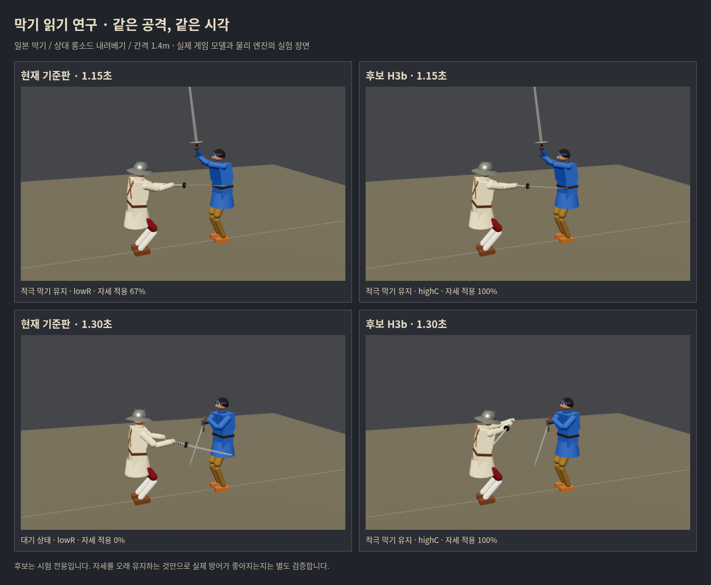

# 막기 읽기 연구 1차 결과 · 샛별 · 2026-10-17

**세 후보 모두 미채택. 게임 코드·공개판·우화 저장소는 변경하지 않았다.**

사용자 ‘실험 시작하자’에 따라 MSG-S-012를 실행했다. 우화 최신 main `f21266d6bcb3c44c02e0bd365a68cda5416ad6d1`을 다시 확인하고 전용 가지 `codex/parry-reading-research-20261017`에서 실험했다. 연구 도구/원자료/이 문서만 추가했다. 기존 콘텐츠 전달 가지와 공개 main은 그대로다. 우화에게 새 답신을 발행하지 않았다.

[사전 계획과 후보별 새 수치](../../design/parry_reading_prereg_2026-10-17.md) · [계산 결과](report.json) · [원문 설계](../../design/parry_reading_research_2026-10-17.md)

## 확인한 원인

1. 일본 B의 첫 칼 충돌13회에서 `defend`와 자세 가중치≥.5가 모두0인 현상을 재현했다. **이는13번 모두 방어에 실패했다는 뜻이 아니다.** 기준판의 칼날 부상은26조건 중1조건이었다.
2. 대표 롱소드 내려베기/간격1.4m에서 대본 손 목표 이동은1.042초에 끝나고 첫 칼 충돌은1.300초에 났다. 기존 읽기는 그 사이 `highC→lowR→idle`로 이동했다. `skill.aim` 자체도 평활화된 목표이며 실제 물리 손/칼과 시차가 있다.
3. `cover.w=1`도 물리적으로 이미 그 자세에 도착했다는 뜻은 아니다. 아래 실제 엔진 사진에서1.15초에는 두 판의 팔 위치가 비슷하지만, 후보의 표기만100%다. 자세 유지 여부·목표 방향·실제 도착을 따로 측정해야 한다.
4. `Senses.seen(.15)`는 **0.15초 과거** 표본이다. 미래 예측이 아니다. 기존 주석의 ‘앞’을 시간 선행 예측으로 해석하지 않았다.



실제 게임 모델·Rapier 물리를 사용한 재현 실험장이다. 합성 시안이 아니며, 일반 스테이지 화면으로 오인하지 않도록 실험장이라고 표시했다. 두 판 모두 같은 시작 상태/공격 대본/시간이다. 브라우저 예외·실패 응답0. 연구 후보의 시각 차이를 보여주는 자료이며 출시 기능 사진은 아니다.

## 비교 규모와 정의

- A는 원문의 절반: **19공격 × 4간격(1.2/1.4/1.6/1.8m) × 공격무기3종 = 방어 구성당228판**. 5유파+무유파+일본 덧씌우기 없음까지7구성. 원문456판의 공식 통과로 부르지 않는다.
- B는 작은 진단 세트26조건을 일본/독일/동방에 그대로 사용했다. C는 실제 보통AI120초×10씨앗으로 원문20씨앗의 절반. 동일 씨앗을 짝지었다.
- H3a/H3c는84판 선별+B에서 제외했고 전체 A/C로 확장하지 않았다. H3b만 전체 절반A와 C를 비교했다.
- ‘부상 판’은 기존 도구와 동일하게 **한 번 이상 베이거나 찔린 판**이다. 모든 둔타 피해를 포함하는 수치가 아니다. 가중치는 원문의19공격 빈도, 분모는 헛침을 포함한 전체228판이다.
- 줄 전환은 서로 다른 이름의 Set 크기가 아니라 시간순 실제 변화 횟수다. 대기 줄도 포함한다. 실측 인간 조작감이나 통계적 유의성을 주장하지 않는다.

## 후보와 폐기 이유

| 후보 | 바꾼 읽기 | 결과 / 판단 |
|---|---|---|
| H3a | 손 속도4.5m/s를 넘을 때 .10초 전 시작 방향을 잡고, 손이 느려진 뒤 .25초 유지 | 레이피어 zornhauL/일본 nocover zornhau 신규부상 각각1. 대각선 베기 악화0 조건 실패. 제외. |
| H3b | 같은 유지 규칙을 중앙 위에서 시작한 긋기에만 적용 | 다른 구성 일부 개선, 일본17→19/228·가중부상+.758%p. 허용+.3%p 초과. 제외. |
| H3c | H3b에 중앙 위 준비 선행 인식 추가 | 동방 B 칼날 부상10→11/26, 일본 선별의 위→다리 신규부상1. 2.4m에서 준비만 한 동작에도 .258초 막기 발동. 제외. |

준비 속도3.39–3.45m/s와 긋기7.44–8.94m/s의 차이로 H3a의4.5를 정했으나, 이는 대본에서의 구분이며 실제 모든 입력의 일반 법칙은 아니다. 후보는 AI의 공격 이름/대본 phase/미래 상태를 읽지 않는다. 기존 감각에 들어오는 `skill.aim`/속도와 칼끝 속도만 사용한다. 유파 자세·패드·보법·몸 물리·막기 빠르기·NAGASHI를 바꾸지 않았다.

### H3b 전체 절반A

| 방어 구성 | 기준 부상/228 | H3b 부상/228 | 가중부상 차이(%p) |
|---|---:|---:|---:|
| 일본 / 우치가타나 | 17 | 19 | +.758 |
| 이베리아 / 츠바이핸더 | 25 | 23 | −.758 |
| 동방 / 청강검 | 17 | 16 | −.379 |
| 독일 / 롱소드 | 21 | 21 | 0 |
| 이탈리아 / 레이피어 | 14 | 13 | −.099 |
| 무유파 / 롱소드 | 24 | 23 | −.379 |
| 일본 / 몸꼴 덧씌우기 없음 | 16 | 14 | −.165 |

일본 신규부상은 롱소드의 위→다리1.2m, 레이피어 내려베기1.6/1.8m다. 구제한 것은 롱소드 위→다리1.4m 하나다. 합계만 좋아 보이는 후보를 전체 개선으로 채택하지 않았다. nocover에서 개선되고 실제 일본 자세에서 악화된 차이는 **읽기와 몸꼴/칼의 물리 상호작용**을 다음 진단에서 분리할 근거다. 이것만으로 현 일본 자세 자체가 잘못됐다고 단정하지 않는다.

### 실제AI C와 줄 전환

| 측정 | 기준 | H3b |
|---|---:|---:|
| 새 칼끼리 접촉 | 950 | 977 |
| 흘려 받기 | 16 | 20 |
| 흘림1회당 접촉 | 59.4 | 48.9 |

1/15 목표에 못 미친다. 같은10씨앗의 소규모 진단이며 우화의20씨앗 수치2583/86을 우리의950/16과 직접 비교하지 않는다. 피해 무효/정지/막기 유지 조건의 빈도 시험이므로 이것으로 실제 생존률 향상을 주장하지 않는다.

같은84판에서 시간순 줄 전환은 기준380, H3a280, H3b374, H3c373회다. 전환 감소만으로 방어가 좋아지지 않았다.

## 접촉 분모에서 발견한 함정

H3a B에서 일본 ‘자세 적용≥.5인 첫 충돌’은0→11회가 됐다. 그러나 기존 롱소드13접촉은 없어지고 **새 츠바이핸더11접촉**이 생긴 것이다. 0/13→11/13 개선이라고 보고하면 잘못이다. 원래13조건에서의 해당 지표는 여전히0이며 전체 칼날 부상은1→1이다.

이에 무방어26조건을 따로 돌렸다. 롱소드13조건 중6조건만 베이거나 찔렸고(간격1.10/1.15/1.20/1.30/1.35/1.50m), 츠바이핸더13조건은0이었다. 기준 막기와 H3a는 둘 다 위험한6조건 중5조건의 부상을 피했다. 후보에서 칼 충돌이 사라졌다는 사실만으로 방어 실패로 볼 수도 없다. 몸과 칼의 움직임이 함께 바뀌기 때문이다.

다음 B는 **실제 위험을 막았는지**, **의도한 유파 막기 자세로 받았는지**, **위험하지 않은 헛공격에 불필요하게 반응했는지**를 별도 집계하는 것이 맞다. 기존 성공기준을 몰래 완화해 후보를 통과시키지는 않았다.

## 접촉 기록과 한계

무방어228판을120Hz로 기록했다. `Combat.strike`의 실제 칼날/몸 호출을 상처 발생과 별도 보존한다. 시작 자세에서 이미 닿는 낮은 힘의 접촉도 있어 ‘첫 호출=공격의 첫 유효 타격’으로 보지 않았다.

초기 v1은 칼날 타격점 속도를 저장했다. 정밀화한 v2는 충돌점의 회전 포함 상대속도를 직전 강체 상태에서 계산하고, 콜라이더 쌍이2.5스텝 넘게 관측되지 않았다가 닿으면 새 접촉 구간으로 표시한다. 이 새 구간 기준은 계측상의 정의다. 시작·지속·재접촉 원자료도 남긴다. v2 재계측228판의 부상/대본 단계는 v1과 전부 같았다.

v2에서 본격 긋기 이후 새 칼날/몸 접촉이 상대속도2.5m/s 이상인 판은78개. H3a가 접촉 순간 방향을 유지한 수는 유예 .15/.25/.35초에서42/45/45개였다. **이는 올바른 방향을 맞춘 정확도가 아니라 유지 상태의 시간적 겹침**이다. 맞은 점 하나만으로 정답 막기 줄을 자동 부여하지 않았다. 원자료의 위치/진입 방향을 다음 연구에 재사용할 수 있다.

이 계측은 대본의 고유 동작에서 발걸음까지 재현하지 않는다(기존 parry_gap_map과 동일). 실제 버튼 놓기/재누르기·모바일 조작 전반을 검증한 출시 구현도 아니다. 후보는 시험 프로세스에서만 켠다.

## 검증과 재현

새 계측 도구와 기존 A 도구의84판 결과 불일치0, 대표15판도 불일치0. 중복 공격 이름의 경로 차이0. v2 계측 보완으로 기존228판 부상 결과가 달라진 경우0.

공통5관문 통과: fights12 `5dfe035c`, live_battery `648aca66`, finish_thrust `2de06c03`, corr12/12 IDENTICAL, weapon_smoke OK23/FAIL0. 기대값은 최신 기준판의 값을 그대로 사용했다. 빌드 통과. 이는 변경하지 않은 게임 소스의 관문이며, 실패한 연구 후보가 출시 검증을 통과했다는 뜻이 아니다. [관문 원본](gates/on-gates.json)

```sh
# 무방어120Hz 기록 (기본19공격·3무기·4간격)
OUT=/tmp/unguarded.json node tools/sim/parry_reading_trace.mjs
# H3b 전체 절반A
CANDIDATE=1 READ_SCOPE=center HELD=1 TRACE=0 CONFIGS=uchigatana,zweihander,qinggang,longsword,rapier,longsword:basic,uchigatana:nocover OUT=/tmp/h3b.json node tools/sim/parry_reading_trace.mjs
# H3b 실제AI10씨앗
READ_SCOPE=center COUNT=1 SEEDS=1-10 TMAX=120 OUT=/tmp/h3b-flow.json node --import ./tools/sim/parry_reading_register.mjs tools/sim/flow_recover.mjs
# 보존된 원자료에서 결과 재계산 (json.gz 자동 읽기)
node tools/sim/parry_reading_report.mjs docs/research/parry_reading_20261017
# 오프라인 재계산
node tools/sim/parry_reading_offline.mjs docs/research/parry_reading_20261017/unguarded-v2.json.gz
```

H3a는 READ_SCOPE를 생략하고 H3c는 `READ_SCOPE=center READ_PREP=1`을 쓴다. 기본 `src`/게임 엔트리는 실험 모듈을 import하지 않는다. 되돌리기는 `CANDIDATE`나 `--import ...parry_reading_register.mjs`를 빼는 것으로 충분하다. 사진 재현은 Vite 개발 서버의 `/tools/sim/parry_reading_visual.html`(빌드/공개 엔트리 아님)이다.

## 다음 연구에 남기는 구체적 과제

이번 세 후보는 더 조정해서 배포하지 않는다. 다음 회차는 기록된 **일본 신규부상3조건·구제1조건과 동방 신규부상1조건**부터 비교해 ‘대기 손을 따른 탓인지 / 덧씌우기 전환이 칼과 몸을 잘못 이동시킨 탓인지’를 구분한다. 손 입력 정지 시간만으로 유예를 늘리는 방향은 중단한다. 실제 팔·칼의 도착과 들어오는 칼의 접촉 위험을 함께 판단하고, 그 소수 조건을 해결한 후보만 다시 전 유파 절반A/C로 올린다. 자세·물리를 변경해야 한다는 결론이 나면 우화 담당 범위와 구별해 보고한다.

보존된 압축 원자료/검증 로그의 SHA256은 [manifest.json](manifest.json)에 있다. 데이터와 실패 후보도 다음 작업자가 같은 실험을 반복하지 않도록 남겼다.
