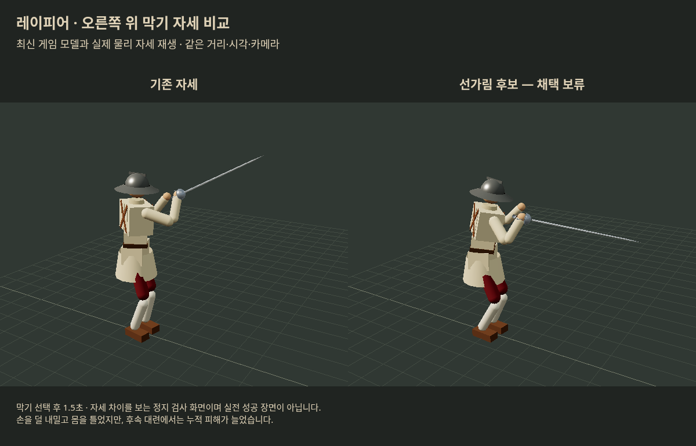

# 레이피어 막기 후속 연구 — 2026-10-19

**이번 후보는 채택하지 않는다.** 대표 실패에서 칼 든 팔을 덜 맞게 할 가능성은 확인했지만, 별도 입력·거리와 30초 전투에서는 피해가 늘었다. ‘팔을 덜 내밀기’보다 **올바른 방어 줄에 제때 도착하고, 다음 위협·반격으로 자연스럽게 전환하기**가 다음 연구의 중심이다.

사용자 ‘연구 수행해’에 따라 [설계 제안](../uhwa_rapier_received_20261019/PROPOSED_STUDY.md)을 실행했다. 기준은 우화 최신 **44b17d86f4b8d595bc452b8a27c8901089c940ab**. 이전98a83cf5와 다른 combat/config/main/nagashi_recovery를 포함해 새 기준을 사용했다. `/tmp` 실험 소스만 변경했다. 현재 포크·우화 게임 소스, 공개 링크, 우화 메시지는 변경하지 않았다.

## 방법과 후보

- 기존 도구 그대로19공격×4거리(1.2/1.4/1.6/1.8m)×상대3무기=228회. 플레이어는 레이피어, 실제 막기 버튼 컨트롤러와 기력 연결, 양쪽 시작 발 묶임 해제. 칼날 상처34/228, 첫 칼날 상처가 칼 든 팔인 조건5개. ‘상처 없음’은 무조건 완전한 방어 성공을 뜻하지 않는다.
- 칼 든 팔 실패5개와 다른 실패7개, 성공 대조12개를 선택. 진단·선별용24조건이며 전체 게임의 대표 확률 표본이 아니다.
- 별도72조건은 공격6종×새거리3개(1.3/1.5/1.7m)×상대2무기×입력시각2개(실제 긋기 시작−.10/+ .05초). 후보 평가 전에 고정했다. 이 묶음의 첫 팔 상처가0이므로 ‘팔 보호 일반화’ 검증으로 확대하지 않는다.
- 30초 비교는 여섯 상대무기×시드2×입력 지연2(.20/.35초), 기존/후보, 플레이어 방어/공격 두 역할=96전. 상대는 실제 normal AI. 사람 쪽은 관측된 칼 이동을 보고 막기를 풀고 접근·탭 찌르기를 하는 프로그램 입력이다. **실제 사람의 베기·손맛·반응을 측정한 시험은 아니다.** 첫 패배에서 종료하고 승패를 별도 보존했다.

| 후보 | 변경 |
|---|---|
| 팔 위협 읽기 `read` | 현재/직전 칼 위치의 속도로 최대.16초 경로 추정. 칼5점과 자기 위팔·아래팔·코등이를 비교,3.5m/s 이상 접근/.20m 안 예상 시 기존 위·아래/좌·우 자세 선택을.12초 유지. 미래 AI 명령은 읽지 않음. |
| 선가림 `shape` | highR/highC 선택 순간부터 몸통을 틀고 손을 덜 내밀며 칼끝을 앞으로 두는 기존 몸꼴 덧씌우기. 접촉 뒤 보너스가 아니다. |
| 결합 `combined` | 위 두 후보 동시 사용. |

선가림 값: 골반−35°/가슴−45°/앞굽힘10°/낮춤.12m, highR 손(.48,.16,.16)m·칼(−4,−9)°, highC 손(.50,.09,.04)m·칼(5,−6)°. 기존 cover 진입.08초/회수.15초. 힘·피해감면·상대 페널티·자동후퇴는 바꾸지 않았다. `tools/rapier_guard_research.js`가 정확한 구현이다.

## 원인 분리에서 얻은 것

대표 실패12개에 **공격 전에 특정 기존 자세를 고정**하는 진단을 했다. 오른쪽 위(highR)는 상처12→4, 첫 칼 든 팔 상처5→0이었다. 다른 고정 자세는 상처7~9개였다. 적절한 기존 자세로 피할 수 있는 장면이 있다는 단서다. 미리 정답을 정하는 조건이므로 실전 성공률이나 사람 이득으로 보고하지 않는다.

기존 선택 줄을 오래 유지하는 안은24조건에서 상처12/팔5로 그대로였다. 준비 자세 따라가기를 끈 진단은11/팔3이었다. 실패 trace에는 높은 자세→낮은 자세 또는 idle을 거쳐 팔 피격 직전 다시 전환하는 장면이 있다. **유지시간 연장만으로 해결되지 않으며, 준비·회수에 따라 잘못 옮기는 선택과 전환 경로가 후보 원인**이다. 모든 실패의 단일 원인으로 확정한 것은 아니다.

## 선별과 별도 조건 결과

| 선택24조건 | 기존 | 읽기 | 선가림 | 결합 |
|---|---:|---:|---:|---:|
| 칼날 상처 조건 | 12 | 11 | 9 | 9 |
| 첫 칼 든 팔 상처 | 5 | 4 | 2 | 2 |
| 새로 방지한/새로 생긴 상처 조건 | — | 1/0 | 5/2 | 5/2 |
| 종료 사지 기능 손실 합계 | 1.742 | 1.794 | 1.417 | 2.080 |
| 종료 의식 손실 합계 | .728 | .729 | .881 | 1.174 |

결합은 같은 피격 횟수여도 실제 피해가 더 컸다. 선가림만 다음 단계로 진행했다. 읽기는 한 조건을 구했지만 전체 사지 손실이 늘어 단독 채택하지 않았다.

| 별도72조건 | 기존 | 선가림 |
|---|---:|---:|
| 칼날 상처 조건 | 14 | 14 |
| 빠른 입력−.10초 / 늦은 입력+.05초 | 7 / 7 | **9 / 5** |
| 종료 사지 기능 손실 합계 | 5.567 | **6.661 (+19.7%)** |
| 종료 의식 손실 합계 | 1.927 | **2.163 (+12.2%)** |
| 종료 혈액 손실 합계 | .0837 | **.1156 (+38.1%)** |

새로 막은2조건 대신 새로 다친2조건이 생겼다. 늦은 입력만 나아진 결과를 입력 안전구간 확대라고 할 수 없다. 위 짧은 검사 손실은 종료 건강값이다. 아래 전투의 ‘피격 순간 손실 누적’과 다른 지표다.

## 30초 득실

플레이어 레이피어 방어 역할24조건의 결과:

| 항목 | 기존 | 선가림 |
|---|---:|---:|
| 플레이어 패배 | 4 | **7** |
| 상대 패배 | 19 | **15** |
| 반격 탭 입력 | 95 | 103 |
| 반격 시도 중 상대에 피해 발생 | 61 | 62 |
| 공통 관찰시간 사지 손실 누적 | 7.905 | **12.336 (+56.1%)** |
| 공통 관찰시간 의식 손실 누적 | 3.809 | 3.648 (−4.2%) |
| 공통 관찰시간 새 출혈률 누적 | 1.149 | **1.696 (+47.7%)** |

각 짝에서 먼저 끝난 시각까지만 피해를 합했다(최대30초). 생존 시간을 줄여 피해가 작게 보이는 오류를 피하기 위해 승패는 각 판 전체 결과로 따로 제시한다. 반격 피해 발생은 해당 입력 구간 중 실제 severity>0 사건이며, 모든 사건이 깨끗한 찌르기 성공이라는 뜻은 아니다.

후보의 덧씌우기 비중이 처음50%를 넘은 시각을 기준으로 같은 시각의 기존판과 비교했다. **성공한 막기 접촉 기준이 아니므로 ‘막기 성공 뒤 보장된 이득’으로 부르지 않는다.** 23짝:

| 시간창 | 받은 사지 기존→후보 | 받은 의식 | 새 출혈률 | 상대에 준 사지 |
|---|---:|---:|---:|---:|
| 첫1초 | .303→2.069 | 0→0 | .0191→.0402 | 4.426→.338 |
| 첫5초 | 1.823→6.006 | .471→.564 | .635→1.178 | 7.383→7.308 |

단기와30초 모두 이 후보를 지지하지 않았다. 신규 패배는 롱소드·일본 상대의 후속 팔/몸통 상처 누적 출혈2건, 동방 상대의 치명상1건이다. 잘 막는 한 자세에서 다음 공격으로 옮길 때의 칼·팔 배치가 바뀌어 후속 경로와 반격 도착이 나빠졌을 가능성이 있다. **몸 틀기·손 위치·칼 각도·전환 중 무엇이 원인인지는 아직 분리하지 않았다.** 상처 수 감소만으로 추천했으면 놓쳤을 손해다.

공격자 역할24조건에서는 플레이어 패배14→15/상대 패배6→6. 그러나 상대 레이피어의 해당 몸꼴이50% 이상 사용된 판은1/24뿐이다. 플레이어 입력이 탭 찌르기 위주라 다른 방어 줄을 주로 유도했다. 이 결과를 충분한 공격자 체감 검증이나 일반적인 AI 상향 근거로 쓰지 않는다.

## 자세·검증·원자료



최신 게임 모델, 같은 highR 지시 후1.5초 물리 자세를 로컬 Chromium으로 재생했다. 관찰용 조명·카메라의 **정지 자세 검사 화면**이며 게임 전체 UI/실전 성공 장면이 아니다. 후보는 손을 덜 내밀지만 칼의 높은 경로도 줄어든다. 사진만으로 전투 이득을 판단하지 않는다.

- highR/highC 기존/후보4개 정지 검사에서 자기 몸 침투0. 실제 관절 수치는 `raw/pose-check.json`. 동적 전환 전체가 인체 범위 안이라는 인증은 아니다.
- 관측 추가 후 기존24조건의 핵심 결과(상처/부위/접촉/줄/거리) 원본 도구와 정확히 같음. 시드별96전에서 같은 역할·무기·지연의 두 시드 결과가 서로 달랐음 확인.
- 실제 연구 hook 호출/후보 몸꼴 비중을 기록. 자세 캡처 재실행4회는 원래 자세 지표와 같음. 브라우저 최종 페이지 오류0.
- 첫 hook 삽입 실패로 작동하지 않은96회는 `raw/invalid-hook-not-installed`에 별도 보존·결과에서 제외. 첫 후보 실행4개 프로세스는 초기화 순서 ReferenceError로 시험0회, `raw/invalid-candidate-init`에 보존. 고친 후 재실행했다.
- 유효 짧은 실행624회(원본228 + 관측 재현24 + 진단120 + hook 확인12 + 후보96 + 별도144), 전투96회, 정지 자세/촬영8회. 재현·선별 반복이 포함되어 독립표본728개가 아니다. 계획의 짧은 약540회보다84회 늘어난 것은 진단/관측 확인이며 무효96회는 별도다. 실패 후보를 대형 탐색으로 확장하지 않았다.

`source-files.tar.gz`에는 고정 SHA의 의존 원문121파일, `source.json`에는 개별 SHA256, `research-hook.patch`에는 실험용 연결1줄, `tools/`에는 후보/진단/전투/분석/화면 도구, `raw/`에는 실패를 포함한 원자료가 있다. `analysis.json`은 재집계 결과이며 에너지 합계를 피해량으로 대신하지 않았다.

재현 준비: `python3 tools/prepare.py /tmp/rapier-replay --deps /workspace/halfsword-codex/node_modules`. 아래 명령은 그 추출 디렉터리에서 실행한다. 원본 체크아웃은 바꾸지 않는다.

```sh
CASES=selection.json UNIQUE=1 NOHOLD=1 CONTACT=1 TRACE=1 VARIANT=shape OUT=/tmp/rapier-selection.json node tools/sim/rapier_probe.mjs
CASES=validation72.json UNIQUE=1 NOHOLD=1 CONTACT=1 VARIANT=shape OUT=/tmp/rapier-validation.json node tools/sim/rapier_probe.mjs
ROLE=defender VARIANT=shape OUT=/tmp/rapier-fights.json node tools/sim/rapier_fight.mjs
```

`base/read/shape/combined`로 후보 비교, `hold/noFollow/fixed-highR` 등은 진단이다. fixed 계열은 `failures12.json` 사용. `python3 tools/analyze.py`는 보존된 모든 원자료를 재집계하며 새 전투를 실행하지 않는다.

## 다음 수정 방향

큰 몸꼴 교체·상시 팔 접기·유지시간 연장을 먼저 적용하지 않는다. **기존 highR가 구한 실제 팔 피격 경로만 분리하고, 그 경로를 읽은 뒤 준비/회수 움직임에 다시 잘못 갈아타지 않게 하는 작은 전환 수정**을 다음 후보로 삼는다. 높은 위협을 가리던 칼 각도를 낮추지 않고, 막기 해제→찌르기 도착까지 함께 검사해야 한다. 현재 연구로 최적 계수나 출시 가능한 개선안을 얻었다고 주장하지 않는다.
